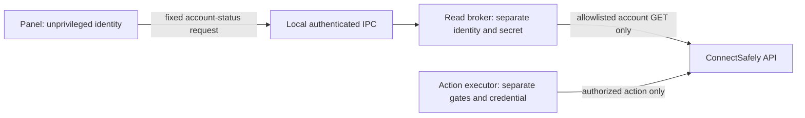

# Apollo + LinkedIn: simulated design

**Spec**: `.specs/features/apollo-linkedin/spec.md`
**Status**: simulated slice, not production-ready

## Architecture Overview

Simulated Apollo task → reader → eligibility and campaign/account checks → atomic scoped reservation in the installation's single official store → executor lock for the selected account → immediate open-task reread → simulated ConnectSafely action → simulated Apollo completion → explicit result. Apollo remains owner of real sequences and emails. No simulated component is wired to production.

## Code Reuse Analysis

`apollo_sequence_readonly.py` is bounded to sequence tools and must not silently gain write capability. `hermes_linkedin_cadence.py` contains useful safety patterns but consumes HubSpot-specific tasks; do not impersonate those tasks. Existing provider and repository tests guide test isolation and state semantics. Do not modify Hermes core or introduce a service, queue or vendor dependency.

## Components

- Reader accepts synthetic task observations and exposes confirmed attributes and missing evidence.
- Simulator validates explicit company, Apollo organization, campaign, task, recipient, default account, approval and response coverage.
- The installation has exactly one official store, shared by all executor processes; missing or unavailable official storage refuses initialization. Independent authoritative stores for one installation are unsupported.
- Reservation protects `(company, Apollo task ID, action type)` before the effect; an executor lock serializes execution by selected LinkedIn account. Immediately before the effect, reread the task and fail closed if it is missing, changed, closed or unavailable.
- A confirmed action and Apollo completion are separate durable simulation states; uncertain outcome requires intervention and no replay of LinkedIn.
- Fake Apollo and LinkedIn providers are test-only; no adapter accepts production credentials or performs network operations.

## Data Models

Reservation uniqueness is company + Apollo task ID + action type; organization, campaign, sequence position, recipient and selected account are independently validated authorization bindings and do not permit duplicate reservations. A repeat with conflicting identity or changed input is blocked, not merged. Follow-up steps remain distinct operations. Approval refers to campaign version and allowed rendered content; no unsupported equivalence is inferred.

## Error Handling Strategy

| Condition | Result |
| --- | --- |
| Empty observations | Empty list; no provider call |
| Missing owner/text/identity, wrong account, stale response | Block with reason |
| Unsupported type, closed or skipped task | Block with reason |
| Provider timeout / uncertainty | Needs attention; do not complete Apollo or retry LinkedIn |
| Apollo completion failure after confirmation | Reconcile Apollo only; never repeat LinkedIn |
| Apollo deleted / no verified readback | Do not assert completion |
| Official store absent or unavailable | Refuse initialization; no effect |
| Account lock held by another process | Do not perform a concurrent effect for that account |
| Immediate task reread unavailable or not open | Block; no effect |

## Risks & Concerns

Actual sequence-generated task search provided ID, type, status, due date, contact and sequence position; detail did not return owner or invitation template. These omissions cannot be inferred from a fixture. Separate-process tests establish only the simulated single-store contract. A real provider may change state between checks; no cross-provider exactly-once guarantee is claimed. Live responses, authorization scope, completion and returned proof remain unverified.

### Read-only account verification: T3 boundary (04/11/2026)

**Status: unresolved; not an operational read-only implementation.** The provider documents GET endpoints for account identity and status, but the public documentation consulted does not establish that its API key can be scoped to reads. On 04/11/2026, a read of the provider's public OpenAPI returned HTTP 200, declared a Bearer security scheme without scopes, and listed no key/scope management endpoint; this does not prove that restricted credentials are unavailable through an authenticated interface or support. A GET-only Python wrapper around a credential able to send prevents accidental calls through that wrapper; it does not make the credential read-only or establish a process security boundary. The existing panel must not receive the sender, its credential, or a bound method whose owner retains those capabilities. While the boundary is unverified, preview and attention must visibly fail closed; they must not claim account readiness or execution-credential binding.

**Required interface:** a read-only account-status port returns an explicit account ID, public identity, availability, source and observation time, or an error. It exposes no send/mutation method and no writable-provider credential to the panel handler. The status observation is not evidence that the separately configured execution credential belongs to this account; execution-binding evidence remains a distinct, independently verified contract. Missing identity, scope, freshness or evidence blocks readiness. No response or receipt can authorize a LinkedIn send.

**Resolution paths to investigate in this order:** (1) provider-documented and verifiably read-scoped credential, used by a dedicated restricted reader; (2) if unavailable, a genuinely separate read-only broker with explicit GET allowlist and an OS-enforced boundary that keeps the provider's send-capable credential outside the panel's security identity. A wrapper, boolean attestation, same-user in-process callback or client with a hidden sender method does not satisfy path 2. The broker is a conditional architecture option, not an installed service or an approved production change; prove the need and operational isolation before adding infrastructure. If neither path can be verified, keep the feature blocked and expose the reason.

**Proposed isolated architecture if the provider does not support read-scoped keys:**

- The panel sends a validated company/account reference, not an arbitrary URL, HTTP method, header, command or credential. The broker uses a trusted per-company allowlist to resolve the reference. It returns only scoped status, timestamps, coverage and static error codes; no credential or complete provider payload.
- Proposed IPC envelope, versioned and size-bounded: request `{version, operation: "account_status", company_id, account_id, request_id}`; response `{version, state, account_id, public_id, observed_at, source, request_id}`. Only trusted mapping determines expected `public_id`; reject extra fields, malformed identifiers and account/company mismatch. Freshness thresholds and exact payload bounds are implementation decisions to be tested, not provider claims.
- A private Unix socket is the proposed IPC on the Linux VPS. Verify peer identity and restrict socket path/permissions; deny unknown callers and account/tenant mismatches. Socket timeout, response-size limits, backpressure and partial coverage keep GET bounded. Neither a socket filename nor a `read_only` flag establishes security.
- Enforce separate nonprivileged service identities and secret-file permissions; confirm the panel cannot read the broker's secret, inspect its process, impersonate it, alter broker configuration or access the provider key through another route. Root or shared privileged identities defeat ordinary Unix file isolation. Verify the effective panel identity and active unit before choosing implementation or rollout.
- Existing unit definitions for adjacent OS services refer to root; they do not establish the active panel's identity. If the panel is root, owner/group file permissions alone cannot protect the broker secret from it; reject that topology unless stronger independently verified isolation is supplied.
- The broker's provider key may be capable of writing; the broker must refuse all write operations by protocol and endpoint allowlist. Do not describe that key as read-scoped unless the provider verifies it. The executor's action capability remains in its independently gated path; do not mount the action credential into the panel.
- Reuse the existing panel preview, account-status validation, account bindings, timeout conventions and official store. Do not add a second authoritative state store, duplicate cadence, scheduler or send path. A broker must be justified by provider limitations and reviewed as a new process; no service, identity, environment file or production setting has been created here.
- A simulated broker contract can test filtering and denial, but **does not prove OS isolation**. Operational acceptance requires a Linux staging test under the intended identities, peer-credential tests, secret-access denial and behavior after broker crash, restart, timeouts and misconfiguration, followed by the independent review requested for T3.
- A hash of a credential **path** does not prove the key's contents, ownership or authority. Resolve and validate the execution binding inside the executor using its own actual credential and independently obtained current evidence; do not accept the read broker's status as proof of that binding.

**Proof before acceptance:** with fake providers, demonstrate that the panel process cannot obtain the send credential or invoke a send route, including adversarial request inputs; demonstrate that account identity and tenant mismatch fail closed; show that the verified execution binding cannot be forged from read-only status; test bounded-time degraded responses, startup without credentials and no external calls. A staging readback with the selected authority is a separate validation; no real message, invitation, task completion or fixture modification is authorized by this design.

Sources: [ConnectSafely account-status reference](https://connectsafely.ai/docs/api/linkedin-account/get-account-status-get-account-status), [API overview](https://connectsafely.ai/docs/api/overview), [workspace roles](https://connectsafely.ai/help-center/workspaces/user-roles). Absence of documented API-key scopes is a documentation gap, not proof that the provider cannot offer them.

## Tech Decisions

Use Python and existing test conventions. Model multi-account routing explicitly; defer full multi-company product. No Node backend or Mastra in this deterministic slice. Live Apollo and ConnectSafely transports, UI and scheduler remain out of scope.
