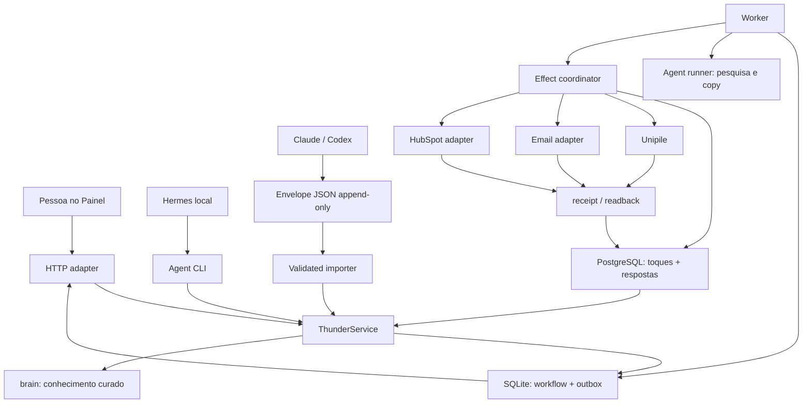

# Thunder OS V1 — Design

**Spec**: `.specs/features/thunder-os-v1/spec.md`
**Status**: Approved for implementation on 2026-09-29

## Architecture Choice

Três abordagens entregariam o mesmo escopo:

| Approach | Vantagem | Custo / risco | Decision |
| --- | --- | --- | --- |
| Evoluir `painel_servidor.py` como arquivo único | Menor patch inicial | O arquivo já tem 1.130 linhas, mistura HTTP, banco, filas, agentes e domínio; aumentaria acoplamento e risco | Rejected |
| Criar um novo serviço/repositório distribuído | Isolamento máximo | Novo deploy, autenticação, banco, observabilidade e operação antes de entregar valor | Rejected |
| Monólito modular no `brain`, usando o Painel atual como casca | Uma implantação, contratos internos claros, migração incremental e rollback simples | Exige disciplina de módulos e uma ponte temporária com dados atuais | **Chosen** |

A escolha segue a autorização do Ygor para priorizar a solução sênior mais simples e a decisão de não recuperar Cockpit/GTM como fundação.

## Architecture Overview

O servidor HTTP continua pequeno e síncrono para leitura e comandos rápidos. Trabalho lento — pesquisa, geração, reconciliação e execução — entra em uma outbox SQLite e é processado por um worker separado. A camada `ThunderService` contém as transições; UI, CLI e agentes nunca gravam tabelas ou arquivos diretamente.



## Authority Map

| Information | Authority | Readers | Writers | Projection / mirror |
| --- | --- | --- | --- | --- |
| Oferta, ICP, provas, estilo e catálogo de sinais | arquivos validados em `thunder/`, `eu/` e `conhecimento/` | research, copy, UI | humanos/agentes conforme `REGRAS.md` | snapshot com hash no artefato de pesquisa |
| Fatos curados da conta | `contas/<slug>/ficha.md` | research, UI, agents | fluxo de promoção validada | índice/projeção SQLite |
| Conversas curadas | `contas/<slug>/conversas.md` append-only | replies, UI, agents | ingestores de canal | referência no ledger de respostas |
| Trabalho, jobs, pesquisas em revisão, cadências, passos e aprovações | SQLite externo do Thunder OS | service, worker, UI | somente `ThunderService` | cards e timelines |
| Reserva, deduplicação, efeito externo e resposta recebida | PostgreSQL de toques | effect coordinator, reply coordinator, UI | adapters/ingestores governados | estado resumido no SQLite |
| Resultado no provider | provider + receipt/readback persistido | reconciliation, UI | provider adapter | toque confirmado e evento |
| HubSpot | espelho comercial | leadership, UI | adapter após autorização | status de mirror no Thunder OS |
| `_log/atividade.jsonl` | auditoria append-only de ações | painel secundário, humanos | todos os executores | nunca governa estado |

O sistema não tenta uma transação distribuída entre SQLite, PostgreSQL e providers. Ele usa outbox, idempotência e reconciliação:

1. `ThunderService` persiste intenção e outbox no mesmo commit SQLite.
2. O worker reclama um job por comparação de versão.
3. Antes do provider, o effect coordinator adquire o lock lógico de pessoa/canal, relê respostas/supressões e reserva o toque no PostgreSQL.
4. O provider é chamado uma vez.
5. Resultado confirmado ou incerto é persistido no ledger antes de atualizar a projeção SQLite.
6. Se houver queda, o reconciliador parte da reserva/receipt existente; nunca repete pelo estado visual.

## Code Reuse Analysis

### Existing Components to Leverage

| Component | Location | How to Use |
| --- | --- | --- |
| Painel e seus estados acessíveis | `_ferramentas/painel_modelo.html` | Evoluir a interface existente; preservar `Hoje`, `Conversas`, `Para aprovar` e `Contas` |
| HTTP validation e path safety | `_ferramentas/painel_servidor.py` | Manter Host, body size, JSON, slug e path validation; delegar domínio ao service |
| SQLite externo e locks | `_ferramentas/painel_servidor.py:206` | Migrar para repository versionado com WAL, migrations e compare-and-set |
| Ledger de toques | `_ferramentas/toques.py` e `toques_schema.sql` | Preservar chave única, reserva, estados `feito/erro/incerto` e respostas |
| Unipile validado | `_ferramentas/linkedin_unipile.py` | Extrair somente transporte e contratos comprovados; não manter Markdown como fila canônica |
| Reflexão estruturada | `_ferramentas/reflexao_semanal.py` | Alimentar experimentos; não promover regra automaticamente |
| Métodos ABM | `skills/priorizar-contas`, `mapear-decisores`, `prospectar-conta` | Converter passos e saídas em schemas de job; as skills continuam guias, não estado |
| Método de cadência | `skills/preparar-sequencia` e `thunder/cadencia.md` | Usar como ponto de partida; intervalos ficam versionados por cadência |
| Classificação e correção | `_ferramentas/toques.py:225` | Preservar reclassificação explícita e histórico |
| Test harness | `_ferramentas/test_*.py` e `_ferramentas/test_*.js` | Manter unittest/Node e ampliar por requisito |

### Explicit Non-Reuse

- Nenhum import, API ou runtime de `/root/projects/thunder-cockpit` ou `/root/projects/thunder-gtm`.
- Nenhum Command Bus, worker, schema, fila ou gate desses projetos.
- Nenhum artefato de `/opt/thunder-cockpit` ou `/opt/thunder-gtm` no release.
- Conceitos coincidentes só entram quando rederivados do PRD e implementados no Thunder OS.

## Components

### Domain Contracts

- **Purpose**: IDs, enums, payload hashing, versioning and allowed transitions.
- **Location**: `_ferramentas/thunder_os/models.py`
- **Interfaces**:
  - `parse_work_item(data) -> WorkItem`
  - `parse_research_artifact(data) -> ResearchArtifact`
  - `parse_cadence(data) -> Cadence`
  - `transition(entity, expected_version, target) -> entity`
  - `payload_hash(payload) -> str`
- **Dependencies**: Python stdlib only.
- **Reuses**: current identifier, URL and field validation semantics.

### Workflow Repository

- **Purpose**: versioned SQLite schema, transactions, outbox and read models.
- **Location**: `_ferramentas/thunder_os/db.py`
- **Interfaces**:
  - `migrate() -> None`
  - `transaction() -> ContextManager`
  - `save(entity, expected_version) -> entity`
  - `claim_job(worker_id, now) -> AgentJob | None`
  - `append_event(event) -> None`
- **Dependencies**: external `PAINEL_DB`/future `THUNDER_OS_DB`.
- **Reuses**: existing SQLite file; migrations are additive and backward compatible.

### Thunder Service

- **Purpose**: the only writer of workflow state and orchestration rules.
- **Location**: `_ferramentas/thunder_os/service.py`
- **Interfaces**:
  - `today() -> TodayView`
  - `request_work(command, actor, idempotency_key) -> WorkItem`
  - `submit_research(artifact, actor) -> ResearchArtifact`
  - `approve_cadence(cadence_id, version, actor) -> Cadence`
  - `record_job_result(job_id, result, actor) -> WorkItem`
  - `record_reply(reply_id, actor) -> ReplyDecision`
- **Dependencies**: repository, knowledge reader, touch ledger.
- **Reuses**: existing card and account projections.

### Knowledge Reader

- **Purpose**: safe, hashed reads of canonical Thunder/account knowledge.
- **Location**: `_ferramentas/thunder_os/knowledge.py`
- **Interfaces**:
  - `load_thunder_context() -> KnowledgeSnapshot`
  - `load_account(slug) -> AccountSnapshot`
  - `promote_validated_facts(slug, facts, source_job) -> PromotionResult`
- **Dependencies**: configured `THUNDER_BRAIN_ROOT`, path validation and file locks.
- **Reuses**: `mapa.md`, `thunder/`, `eu/`, `conhecimento/`, `contas/`.

### Agent Gateway and Runner

- **Purpose**: accept idempotent work envelopes and execute only research/copy tools.
- **Locations**: `_ferramentas/thunder_os/agent_gateway.py`, `_ferramentas/thunder_os/agents.py`
- **Interfaces**:
  - `ingest(envelope) -> WorkItem`
  - `claim(actor, capabilities) -> AgentJob | None`
  - `complete(job_id, expected_version, result) -> WorkItem`
  - `run(job) -> AgentResult`
- **Dependencies**: service; configured commands; JSON schema validation.
- **Reuses**: Hermes subprocess invocation but removes arbitrary JSON scanning and 180-second work from HTTP request threads.
- **Constraint**: agents can propose and return evidence; they cannot approve, dispatch or spend.

### ABM Research

- **Purpose**: account-first dossier, evidence freshness, opportunity hypothesis and Thunder fit.
- **Location**: `_ferramentas/thunder_os/research.py`
- **Interfaces**:
  - `build_brief(account, campaign) -> ResearchBrief`
  - `validate_artifact(result, knowledge_hash) -> ResearchArtifact`
  - `recommend(artifact) -> abordar | acompanhar | pesquisar_mais | nao_priorizar`
- **Dependencies**: knowledge reader, signal catalog and agent gateway.
- **Reuses**: existing ABM skills and account templates.

### Cadence Engine

- **Purpose**: versioned multi-touch plan, due calculation, response stop and dependent blocking.
- **Location**: `_ferramentas/thunder_os/cadence.py`
- **Interfaces**:
  - `create(person, steps, research_id) -> Cadence`
  - `approve_pack(cadence_id, version, actor) -> ApprovalPack`
  - `due(now) -> list[CadenceStep]`
  - `pause_for_reply(person_key, reply_id) -> list[CadenceStep]`
  - `reconcile(step_id) -> CadenceStep`
- **Dependencies**: repository, approvals, touch ledger.
- **Reuses**: cadence template, business-day behavior and existing stop rules.

### Approval Service

- **Purpose**: one human decision for an exact versioned pack without repeated gates.
- **Location**: `_ferramentas/thunder_os/approvals.py`
- **Interfaces**:
  - `approve_pack(cadence, actor, expires_at) -> ApprovalPack`
  - `authorize_step(step, pack, now) -> Authorization`
  - `invalidate_affected(pack, changed_step_ids) -> ApprovalPack`
- **Dependencies**: domain contracts and repository.
- **Reuses**: exact-content protection already present in current Panel and LinkedIn tests.

### Effect Coordinator and Provider Adapters

- **Purpose**: reserve, execute once, persist receipt/uncertainty and reconcile.
- **Locations**: `_ferramentas/thunder_os/worker.py`, `_ferramentas/thunder_os/providers/`
- **Interfaces**:
  - `execute_due(step_id) -> EffectResult`
  - `UnipileAdapter.send(effect) -> ProviderResult`
  - `EmailAdapter.send(effect) -> ProviderResult`
  - `HubSpotAdapter.mirror(effect) -> ProviderResult`
- **Dependencies**: cadence, approval service, `toques`, provider credentials.
- **Reuses**: current Unipile transport and HubSpot read/write policy only; no legacy runtime.

### Reply Coordinator

- **Purpose**: correlate inbound replies, pause cadence and create the next human decision.
- **Location**: `_ferramentas/thunder_os/replies.py`
- **Interfaces**:
  - `ingest(reply) -> Reply`
  - `classify(reply, proposal) -> Classification`
  - `correct(reply_id, classification, actor) -> Classification`
  - `apply_stop(reply) -> Cadence`
- **Dependencies**: touch ledger, cadence and service.
- **Reuses**: existing reply table and explicit reclassification.

### Web Adapter

- **Purpose**: render user work and translate HTTP to service calls.
- **Locations**: `_ferramentas/painel_servidor.py`, `_ferramentas/painel_modelo.html`
- **Interfaces**:
  - `GET /api/os/v1/today`
  - `GET /api/os/v1/accounts/<slug>`
  - `POST /api/os/v1/work-items`
  - `POST /api/os/v1/research`
  - `POST /api/os/v1/delegations/hermes`
  - `POST /api/os/v1/likes`
  - `POST /api/os/v1/cadences/<id>/approve`
  - `POST /api/os/v1/replies/<id>/classify`
- **Dependencies**: Thunder Service.
- **Reuses**: existing same-origin UI, partial failures and accessibility patterns.

## Data Models

Every mutable entity has `id`, `version`, `created_at`, `updated_at` and validated `status`. IDs are opaque, lowercase and server-generated. Payloads are canonical JSON before SHA-256 hashing.

### WorkItem

```text
id, kind, title, account_slug?, person_key?, objective, status,
next_action, assignee?, idempotency_key, source_ref?, result_ref?, version, timestamps
```

Statuses: `pending`, `queued`, `running`, `needs_human`, `blocked`, `failed`, `done`.

### AgentJob

```text
id, work_item_id, job_type, input_json, input_hash, status,
claimed_by?, lease_until?, attempts, result_json?, error_code?, version, timestamps
```

Statuses: `queued`, `running`, `needs_human`, `failed`, `succeeded`. Internal research jobs may retry with bounded attempts; provider effects are not AgentJobs and never auto-retry.

### ResearchArtifact

```text
id, account_slug, status, knowledge_hash, facts[], explicit_intent[], indicators[],
counter_signals[], counter_signal_assessment, research_gaps[], source_coverage[],
evidence_chains[], inferences[], opportunity_hypothesis, alternative_hypothesis, thunder_fit[],
committee[], committee_gaps[], risks[], missing[], limitations[], recommendation,
source_job_id, version, timestamps
```

Each fact contains a stable `fact_id`, source URL and area, the source publication date when present, and `observed_at` as the collection date. `freshness` is derived from publication date: `fresh`, `stale`, or `undated`. Classification separates explicit intent, indicators, counter-signals, and context. Every fact must cite an evidence chain with an implication, an alternative explanation, a bounded value hypothesis, and a question that could disprove it.

Coverage records account for the company site, company news and social, Google/Meta/LinkedIn ad libraries, hiring, sector, decision-maker career, and other public sources. Each row records planned, attempted, discovered and evidence URLs. A checked no-result requires a recorded request and is not positive account evidence. Inaccessible, unprovided or parser-limited areas remain visible gaps. Search claims must match the trusted evidence packet; model output cannot add facts, dates, source URLs, or checked coverage.

`validated` and `abordar` require at least two current source records, two distinct public URLs, a fact from the official account domain, and a dated recent intent/indicator that supports the hypothesis. No high-severity counter-signal or unresolved gap marked `blocks_hypothesis` may remain; canonical fit must be approved. Explicit buying intent and verified decision-maker tenure are useful but not universal. Incomplete areas need named source-access gaps and a refuting/qualification question; those gaps may be nonblocking when the core hypothesis remains evidence-backed. A checked no-result, fallback package or single signal cannot replace positive evidence. A cached status never bypasses the gate.

### Cadence and CadenceStep

```text
Cadence: id, account_slug, person_key, research_id, status, timezone,
         approval_pack_id?, current_step, version, timestamps
Step: id, cadence_id, ordinal, channel, action, due_at, payload,
      payload_hash, depends_on?, status, touch_id?, receipt_ref?, version
```

Cadence statuses: `draft`, `ready_for_review`, `approved`, `active`, `paused_reply`, `blocked`, `completed`, `cancelled`. Step statuses: `draft`, `approved`, `due`, `reserved`, `sending`, `sent`, `uncertain`, `failed`, `skipped_reply`, `cancelled`.

### ApprovalPack

```text
id, cadence_id, cadence_version, actor, approved_at, expires_at,
step_hashes[], status, invalidated_step_ids[], version
```

Statuses: `active`, `partially_invalidated`, `invalidated`, `expired`, `consumed`.

### Event

```text
id, entity_type, entity_id, event_type, actor, data_json,
correlation_id, causation_id?, occurred_at
```

Append-only. Sensitive payload bodies are referenced by hash/ref, not duplicated in events.

## State and Timing Rules

- All business time uses `America/Sao_Paulo`; storage timestamps are timezone-aware UTC.
- A cadence step becomes due from the confirmed completion time of its dependency, not from queue time.
- Weekend adjustment is explicit in the cadence version; no silent calendar rewrite after approval.
- Reply, opt-out or suppression wins over a due step. Both reply ingestion and pre-send reservation use the same person/channel logical lock in PostgreSQL.
- `uncertain` is terminal for automatic execution and requires reconciliation.
- Any change to target, channel, content, order or interval increments the cadence version and invalidates affected future step hashes.
- Global pause is checked at approval display and immediately before reservation/provider call.

## Error Handling Strategy

| Error Scenario | Handling | User Impact |
| --- | --- | --- |
| Knowledge file missing/invalid | Mark research input incomplete; do not fabricate | “Falta confirmar…” with next action |
| Agent timeout/invalid JSON | Fail job with bounded diagnostic; keep original item | Retry research or revise request |
| SQLite unavailable | Reject writes; serve only independently safe reads | Affected card shows unavailable |
| PostgreSQL touch ledger unavailable | Block all external effects | “Envio protegido; histórico indisponível” |
| Duplicate reservation | Reconcile existing touch/receipt | Existing result shown; no new send |
| Provider rejects | Persist `failed` with sanitized code | Manual correction/retry if allowed |
| Provider timeout after request | Persist `uncertain`; no retry | “Precisa conferir” |
| Reply races with due send | Person/channel lock; reply pause checked before reservation | Future touch is skipped |
| HubSpot write accepted without readback | Keep mirror `pending_reconciliation` | No success claim |
| Email provider absent | Adapter reports `not_configured`; LinkedIn and manual work continue | Email step blocked with setup instruction |
| Partial UI source failure | Independent request and local error | Other sections remain usable |

## Authentication and Trust Boundaries

- The public web surface remains behind HTTPS and nginx Basic Auth in V1.
- Nginx forwards the authenticated username; the loopback-only app accepts that header only from the configured proxy path.
- Every browser mutation validates exact `Origin` and a session nonce to prevent cross-site writes.
- Agent ingress is local CLI or append-only validated envelope in `_entrada/<agent>/thunder-os/`; file path identifies claimed actor but does not grant effect authority.
- Hermes effect delegation requires a separate server-side credential, persisted scopes, an atomically reserved daily ceiling and a kill switch rechecked by the worker before the provider call. Follow-ups, LinkedIn likes and internal HubSpot writes use the same audit actor `hermes (delegado)`; first touch, new person and suppression override remain human-only.
- Claude and Codex cannot approve or dispatch. Hermes cannot set receipts, `sent`, `done` or provider identifiers and can dispatch only an unchanged follow-up from a human-approved cadence.
- Secrets remain in the profile environment; reports, events and error messages never include them.

## Release and Runtime

```text
source commit in brain
  -> scoped build artifact
  -> /opt/thunder-os/releases/<timestamp>-<sha>/
  -> offline tests + manifest/hash
  -> candidate smoke with copied SQLite backup
  -> serialized symlink promotion /opt/thunder-os/current
  -> restart web + worker
  -> production read journey
  -> optional explicitly authorized external canary
```

- Mutable state: `/var/lib/thunder-os/` after migration from the current `painel-dados`; owner/mode recorded.
- Knowledge root: `/root/.hermes/profiles/ygor-personal/brain`, passed as `THUNDER_BRAIN_ROOT` and never used as code root.
- Web and worker expose their source revision in `/saude`; production verification compares both.
- Rollback changes the symlink to the prior known-good release and restores DB only when the migration contract requires it.
- Retention follows one active, two known-good rollbacks and at most one candidate; deletion remains separately authorized.

## Verification Strategy

- Unit tests map every domain transition and every PRD edge case.
- Repository tests use temporary SQLite with migrations, restart and concurrency.
- Provider tests use mocked transport and prove single attempt, sanitized failure and uncertain outcome.
- HTTP tests cover authentication headers, Origin/nonce, validation and partial failures.
- Browser tests cover the daily ABM → cadence → approval → reply journey at desktop and mobile.
- Production verifier binds source SHA, release manifest, service paths, DB schema, health and one read-only journey.
- A real external canary is separate and only runs with explicit authorization for target, channel, content and cost.

## Risks & Concerns

| Concern | Location | Impact | Mitigation |
| --- | --- | --- | --- |
| HTTP, persistence, domain, files and agents share one 1.130-line module | `_ferramentas/painel_servidor.py:206` | Every new capability increases regression radius | Extract modules behind a compatibility service before adding behavior |
| Generic JSON tables allow arbitrary states | `_ferramentas/painel_servidor.py:217` | Invalid transitions can be persisted | Add normalized tables, enums, versions and migrations; retain old tables as read compatibility |
| Approval currently writes Markdown queues directly | `_ferramentas/painel_servidor.py:359` | Git-synced files act as execution authority and can race | New effects use outbox + ledger; queue bridge remains read-only compatibility until cutover |
| Hermes runs synchronously inside an HTTP request for up to 180 seconds | `_ferramentas/painel_servidor.py:945` | Slow UX, thread exhaustion and ambiguous retries | Move to AgentJob worker and poll item state |
| Workflow and touch state span SQLite/PostgreSQL | `painel_servidor.py`, `toques.py` | Crash can leave projections divergent | Durable outbox, stable refs, person/channel lock and reconciliation tests |
| Current service runs source from mutable synced `brain` | `/etc/systemd/system/painel-thunder.service` | Sync can change runtime without release evidence | Immutable `/opt/thunder-os/current` release and external knowledge root |
| Web authentication is only nginx Basic and app has no actor/CSRF model | `painel-nginx.conf`, `painel_servidor.py:979` | Mutations lack explicit actor and defense-in-depth | Forward authenticated user, validate Origin and nonce, keep loopback binding |
| ICP/cadence documents disagree on tiers and sequence length | `thunder/contexto-consolidado.md` | Research and scheduling could produce conflicting decisions | Version a V1 campaign policy during implementation; unresolved data becomes `needs_human` |
| Live email provider is not configured or evidenced in the new profile | profile environment and `skills/verificar-prontidao` | Multi-channel live acceptance cannot pass yet | Build a provider-neutral adapter; choose/configure provider before live email task and keep fail-closed |
| Current tests are broad but do not cover a complete Thunder OS journey | `_ferramentas/test_*.py`, `_ferramentas/test_*.js` | Green baseline could hide missing producer-to-consumer behavior | Add a spec-anchored journey harness and discrimination verification |

## Tech Decisions

| Decision | Choice | Rationale |
| --- | --- | --- |
| Application shape | Python stdlib modular monolith | Matches deployed stack and avoids a new platform |
| Long work | Durable AgentJob/outbox + separate worker | Removes blocking HTTP and makes retries observable |
| Workflow store | Existing external SQLite, migrated additively | Lowest-risk path for single-workspace V1 |
| Effects/replies | Existing PostgreSQL touch ledger | Proven unique reservation and reply history |
| Agent interface | Shared service through local CLI + validated append-only envelopes | Supports Hermes/VPS and Claude/Mac without MCP dependency |
| MCP | Deferred adapter over the same service | Useful later, but not necessary to make V1 functional |
| Provider retries | No automatic retry after provider call | Prevents duplicate external effects |
| Legacy | Reference-only, zero runtime dependency | Preserves the clean product boundary |

## Requirement Mapping

| Requirement | Design owner | Verification focus |
| --- | --- | --- |
| TOS-01 | Web Adapter + Thunder Service | useful daily view, partial failure, latency |
| TOS-02 | Knowledge Reader + Service | identity, provenance, account history |
| TOS-03 | ABM Research | current facts, alternative hypothesis, Thunder fit |
| TOS-04 | Agent Gateway/Runner | idempotent request and result |
| TOS-05 | Approval Service | exact version/hash and global pause |
| TOS-06 | Cadence Engine | due steps, ordering, response stop |
| TOS-07 | Effect Coordinator | reservation, receipt, uncertain result |
| TOS-08 | Reply Coordinator | correlation, correction, suppression |
| TOS-09 | Learning path | evidence, experiment, human promotion |
| TOS-10 | Repository + Release | auth, concurrency, restart, rollback |
