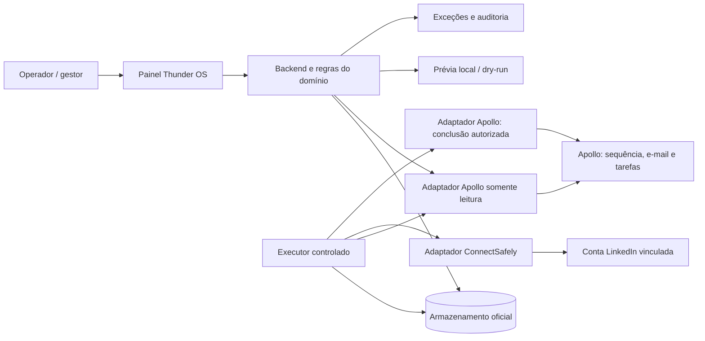

# Thunder OS — visão, especificação, arquitetura e plano de execução

**Documento de contexto para avaliação externa — 03/11/2026**  
**Responsável pelo produto:** Ygor Bueno / Thunder Mustard  
**Estado:** proposta consolidada; não é prova de funcionamento, aprovação de envio ou autorização de deploy.  
**Objetivo:** permitir que um especialista ou o Entire entenda o produto desejado, avalie o código existente e ajude a executar o plano sem reinventar o sistema.

## Decisões de produto registradas em 04/11/2026

Estas decisões de Ygor complementam e, em caso de divergência, prevalecem sobre propostas mais antigas e sobre a resposta do Gemini no fim do documento. Descrevem o produto desejado, não funcionalidades já comprovadas.

1. **Dois modos de campanha:** com Apollo, ele continua criando e enviando os e-mails da sequência, inclusive com seus próprios prompts e IA; o Thunder OS prepara e executa as ações de LinkedIn. Na campanha nativa, o Thunder OS prepara e-mails e LinkedIn e controla a cadência completa.
2. **Pesquisa e conteúdo:** após aprovar a campanha e suas regras, a empresa autoriza a pesquisa e a preparação de abordagens personalizadas. Considerar pesquisa ABM de empresa e decisor, sinais com fontes e datas, histórico, hipóteses e método de cadência, conforme a campanha. Sinal não é prova de intenção; fatos não confirmados não devem ser inventados. Skills como `prospectar-conta` e `montar-cadencia-thunder` são referências de processo, não prova de integração existente nem regras universais obrigatórias para cada cliente.
3. **Profundidade escolhida pelo usuário:** o responsável configura pesquisa profunda ou essencial na campanha. A IA não escolhe autonomamente nem reduz o nível silenciosamente; se não conseguir cumprir, mostra a limitação.
4. **Uma conversa entre canais:** antes de personalizar, buscar e reconciliar o histórico disponível no CRM, no Apollo, na caixa de e-mail e no LinkedIn/ConnectSafely, conforme conexões e capacidades comprovadas. Distinguir fontes e cobertura, reconhecer a mesma interação em fontes diferentes sem apagar sua origem e não presumir que histórico parcial está completo. Se o texto exato do e-mail Apollo não estiver disponível, é permitido usar briefing, estratégia, pesquisa e demais histórico confirmado; a mensagem não pode fingir conhecimento ausente.
5. **CRM como memória comercial:** criar ou associar contatos e registrar as interações encontradas fora do CRM conforme regras da empresa, com verificação de identidade e prevenção de duplicidade. Divergência de identidade vai para resolução; não criar associações por suposição. O banco operacional da instalação continua sendo a autoridade de reservas e execução.
6. **Indisponibilidade do CRM:** a campanha pode continuar quando outras fontes permitem verificar o histórico e as respostas necessários; guardar a sincronização pendente e retomá-la quando o CRM voltar. Se informações necessárias à ação segura não puderem ser verificadas, a ação aguarda. Isso não torna o CRM a única fonte obrigatória de histórico.
7. **Remetentes diferentes da mesma empresa:** um e-mail pode ser enviado por uma pessoa e o contato seguinte no LinkedIn por outra. A personalização deve tratar o contato como continuação, sem inventar nome, relação, conteúdo ou envio. A atribuição de tarefa Apollo não determina por si só a conta LinkedIn; usar a conta vinculada à campanha conforme as regras já aprovadas. Uma pessoa pode ter várias caixas de e-mail.
8. **Cadastro de equipe opcional:** vincular pessoas, caixas e perfis é útil para contextualizar, mas não é requisito para criar ou executar campanhas. Usar apenas relações verificadas. A conta LinkedIn que vai agir precisa ser identificada; quando a tarefa não a indicar claramente, usar a padrão da campanha; se a conta necessária estiver ausente ou indisponível, a ação aguarda.
9. **Convite LinkedIn:** após confirmação de envio do convite, concluir a tarefa correspondente no Apollo, respeitando verificações e condições de segurança; não esperar o aceite para concluir. Enfileiramento ou resultado incerto não são confirmação de envio. O aceite isolado de convite não é resposta e não pausa a cadência.
10. **Resposta humana:** resposta por e-mail ou LinkedIn pausa os próximos contatos automáticos. A IA pode classificar a resposta, considerar o histórico e sugerir texto e próxima ação; uma pessoa revisa e decide antes de enviar a resposta. Pedidos de não contato bloqueiam novos contatos.
11. **Resposta automática de ausência:** identificar como ausência, não como interesse; pausar temporariamente e retomar após a data informada quando identificada com segurança. Sem data clara, encaminhar para revisão. A retomada continua sujeita à revalidação de respostas, recusas e demais regras da campanha.
12. **Proteção comercial antes de matricular:** consultar CRM e histórico para identificar pedido de não contato, campanha ativa duplicada e negociação em andamento. Bloquear não contato, evitar duplicidade e aplicar a regra configurável da empresa para negociação ativa.
13. **Infraestrutura:** não migrar o banco ou reescrever a stack agora. Avaliar reforços como proteção do painel, backup com restauração testada, monitoramento e rastreabilidade; Vercel ou Cloudflare Workers somente para necessidade demonstrada. Nenhuma ferramenta adicional foi aprovada para implantação por este documento.
14. **Economia de pesquisa:** aproveitar infraestrutura e serviços existentes quando adequados; consultar dados já disponíveis, reaproveitar pesquisa válida da empresa entre contatos da mesma conta e atualizar fatos e sinais conforme data e necessidade. Usar modelos e ferramentas proporcionais à tarefa, mantendo fontes, qualidade, isolamento entre empresas e o nível de profundidade escolhido pelo responsável. Medir custo por conta e campanha, alertar e aplicar teto opcional por campanha, conforme A8.
15. **Alternativas a validar:** VPS, Mac, Cua Space, Playwright e Firecrawl são possibilidades, sujeitas à disponibilidade, custo e acesso permitido; não presumir que OAuth do Codex autorize ou suporte o uso como backend automático. IP rotativo não é dependência aprovada; avaliar apenas diante de necessidade legítima comprovada. O teto por campanha é opcional; quando atingido, novas pesquisas param, sem reduzir a profundidade escolhida.
16. **Jornada nativa de referência em 14 dias:** começar sempre com e-mail no D0; incluir solicitação de conexão LinkedIn e uma espera. Se o convite não for aceito, seguir com o segundo e-mail; se for aceito, enviar mensagem LinkedIn. Sem resposta, seguir com outro e-mail, outra mensagem LinkedIn, um e-mail de encerramento e uma última mensagem LinkedIn. O gestor configura passos, intervalos e condições; a sequência fornecida é referência, não imposição de datas intermediárias que ainda não foram definidas. O tratamento de mensagem LinkedIn quando a conexão ainda não tiver sido aceita depende das capacidades efetivas do provedor e deve ser definido sem presumir entrega.
17. **Resposta urgente com contexto:** resposta de pessoa em qualquer canal interrompe a cadência inteira, com pausa externa confirmada quando o fornecedor permitir, e gera destaque urgente no painel para revisão humana e resposta. A ficha do lead deve reunir cronologia, e-mails, mensagens, remetentes, pesquisa, fontes, respostas e demais informações comerciais disponíveis, indicando lacunas e sem duplicar eventos. A IA pode sugerir resposta, mas uma pessoa decide antes do envio. Aceite isolado de convite não é resposta; ausência automática segue a regra de pausa temporária já registrada.
18. **Construtor flexível de cadência nativa:** o responsável define a quantidade e distribuição de toques por canal, o horizonte em dias corridos, intervalos, ordem e condições; por exemplo, 5 toques em dias distintos ou 10 toques em 21 dias (7 e-mails e 3 passos LinkedIn). E-mail inicial no D0 conforme decisão já registrada. Os 14 dias anteriores são exemplo, não limite fixo. O plano deve suportar espera e ramificações como convite aceito → mensagem LinkedIn; convite ainda não aceito → e-mail; resposta humana → interromper toda a cadência e sinalizar urgência. Passos LinkedIn dependem da capacidade real da conta e do provedor.
19. **Decisão por regras, sem LLM obrigatório em cada passo:** guardar a estrutura de campanha aprovada com passos, condições e esperas explícitas; o executor avalia eventos e estados verificados para escolher o próximo passo. IA pode auxiliar pesquisa, planejamento e texto dentro das regras aprovadas, mas não é necessária em toda avaliação de condição. Estado desconhecido não equivale a não aceito ou não respondeu: aplicar a política da campanha quando comprovável, senão aguardar e mostrar o motivo. Definir e validar horário, fuso, vencimento e condições de retomada antes da implementação.
20. **n8n como opção, não decisão:** avaliar Community Edition auto-hospedada para integrações e automações auxiliares, sem duplicar o dono da cadência, o armazenamento oficial ou as garantias de execução. Embora a licença comunitária não tenha cobrança para usos permitidos, há custo de infraestrutura e manutenção. Antes de usá-lo no produto para outras empresas, confirmar o caso de uso e licenciamento: clientes configurando automações baseadas em n8n, mesmo por interface própria, podem exigir licença comercial. Fonte: https://support.n8n.io/article/can-i-use-your-license-for-my-use-case . Nenhuma instalação ou migração foi decidida.
21. **Janelas de envio por campanha:** o responsável configura dias permitidos, faixa de horário e fuso de referência dos destinatários. Os intervalos da cadência são contados em dias corridos; se um passo vencer fora da janela, aguarda a próxima janela permitida e revalida resposta, autorização e demais condições antes de executar. Janelas e fuso específicos não foram escolhidos como padrão global.
22. **Múltiplas contas e limites:** cada empresa pode conectar uma ou várias contas de LinkedIn e uma ou várias contas de e-mail, sem quantidade fixa de produto definida nesta decisão; a quantidade viável depende das capacidades e limites dos provedores. O responsável configura limites diários por conta e tipo de ação (e-mail, convite e mensagem), e a campanha pode adotar limite menor. Quando o limite for atingido, ações aguardam; não trocar silenciosamente a conta. Distribuição entre contas LinkedIn autorizadas está prevista na decisão seguinte; a política operacional detalhada ainda precisa de especificação. Validar limites efetivos e disponibilidade de cada integração.
23. **Distribuição por canal:** a conta de e-mail é fixa para a jornada do lead; contas de LinkedIn podem variar conforme a configuração da campanha. Oferecer duas opções: responsável escolhe a conta de LinkedIn de cada passo, ou autoriza distribuição automática entre contas selecionadas na campanha. Cada ação registra a conta real e mantém a continuidade da conversa entre remetentes. Respeitar limites e regras aprovadas; não supor troca automática quando uma conta atingir limite sem política explícita. Em campanhas Apollo, verificar o remetente efetivo e as capacidades de configuração da sequência antes de garantir esse vínculo.
24. **Mensagem LinkedIn sem conexão aceita:** em cada passo, oferecer configuração para esperar o aceite pelo prazo definido ou, terminado esse prazo sem aceite comprovado, seguir o caminho alternativo configurado, como e-mail. Verificar a conexão da conta que efetivamente enviará a mensagem; o aceite em outra conta não prova conexão nesta. Se o estado não puder ser verificado, aguardar e informar, sem presumir recusa nem executar o caminho baseado em ausência comprovada. Capacidades e eventos dependem de validação do ConnectSafely.
25. **Origens de leads e CSV:** permitir selecionar pessoas de uma sequência Apollo, selecionar contatos do CRM ou importar uma lista em arquivo CSV/planilha suportada. Na importação, identificar cabeçalhos e sugerir mapeamento de campos (nome, empresa, cargo, e-mail, LinkedIn e outros presentes), apresentar prévia e permitir correção antes de confirmar. Validar linhas, sinalizar dados ausentes ou ambíguos e duplicidades, preservar origem e não inventar dados; identificar e associar ao CRM conforme políticas da empresa. Suporte a formatos de planilha além de CSV será especificado e validado separadamente.
26. **Informações de contato ausentes:** a campanha pode buscar dados faltantes nas fontes e serviços autorizados e/ou seguir apenas pelos canais disponíveis quando houver caminho configurado. Se o lead não tiver e-mail nem LinkedIn e esses dados não forem encontrados, oferecer busca de outro decisor da mesma empresa com cargo semelhante, preservando a identidade do lead original e apresentando fonte e cargo do candidato. A campanha oferece escolha entre apresentar candidatos para seleção humana ou selecionar automaticamente conforme critérios configurados e aprovados. Toda substituição deve ficar visível e rastreável; se não houver candidato válido ou houver ambiguidade, encaminhar para decisão humana. Validar e deduplicar o novo contato e respeitar as regras de não contato e campanhas ativas antes de matriculá-lo.
27. **Painel de resultados e andamento:** mostrar leads admitidos, ativos, pausados, com dados pendentes e que completaram a cadência; ações confirmadas por canal, respostas, interessados, pedidos de não contato, reuniões registradas e itens que precisam de atenção. Exibir percentual de leads que concluíram e andamento de toques de forma identificada, com denominador e critérios claros, sem tratar etapas puladas, pausas por resposta ou resultados incertos como envios confirmados. Mostrar previsão da data de conclusão da campanha quando houver dados suficientes, como estimativa recalculável por limites, janelas, ramificações e pausas; quando não for possível prever com confiança, indicar o motivo. Não prometer data exata para leads ainda aguardando aceite ou resposta. Separar quem concluiu todos os passos de quem encerrou por resposta; oferecer visão da coorte inicial e visão atual, com data e cobertura da estimativa.
28. **Falhas e reconciliação:** falha comprovada antes de qualquer envio pode ser tentada novamente conforme limites e política configurados. Resultado de envio incerto não recebe nova tentativa automática e aparece urgente para conferência. Se o canal confirmar a ação e Apollo ou CRM falhar na atualização, preservar a evidência e reconciliar apenas a atualização pendente, sem repetir o envio. A conclusão no Apollo exige revalidação das condições e da resposta antes de avançar a sequência. Resultado aceito/enfileirado não é confirmação de entrega.
29. **Responsável e alertas:** permitir definir responsável por campanha para receber no painel os destaques de respostas urgentes, erros e decisões pendentes. Sem responsável definido, apresentar os alertas no painel geral e encaminhar o e-mail ao administrador da empresa. Enviar imediatamente os alertas previstos em A9 e agrupar os demais alertas técnicos em resumo diário por campanha; cadastro de equipe continua opcional. Provedor de notificação, conteúdo, deduplicação e escalonamento ainda precisam ser especificados. Envio externo sujeito à autorização aplicável.
30. **Dois modelos de operação para outras empresas:** suportar empresa usando seu próprio painel e operação gerenciada pela equipe da Thunder, que configura e opera campanhas para a empresa. Os modelos podem coexistir conforme permissões definidas. No modelo gerenciado, o acesso do cliente ao próprio painel e ao acompanhamento em tempo real é opcional por cliente. Isolar dados, contas, histórico e credenciais por empresa; permissões de acesso da equipe gestora e capacidade do cliente criar ou aprovar campanhas exigem configuração e definição de produto. Multiempresa completo vem após a primeira jornada comprovada.
31. **Permissões configuráveis:** quando houver acesso de cliente, configurar por empresa e usuário as permissões de acompanhar, participar de respostas, criar e aprovar campanhas; também limitar quais pessoas da equipe gestora acessam cada empresa. Aplicar autorização no servidor e impedir acesso cruzado. Os papéis padrão são administrador, gestor e operador, com permissões editáveis; cadastro da equipe comercial para personalização segue opcional.
32. **Lead sem e-mail:** na jornada nativa, pode começar pelo LinkedIn e seguir uma cadência somente LinkedIn quando não houver e-mail disponível; a regra anterior de e-mail no D0 vale para cadências que tenham e-mail, com esta exceção. Em Apollo, a entrada e a sequência reais dependem da configuração e da capacidade do provedor; não presumir matrícula. Verificar conexão e possibilidades reais de mensagem por conta.
33. **Datas após ausência e atraso:** em pausa por férias/fora do escritório com data identificada, retomar no dia seguinte à data informada, sujeito à janela da campanha, rechecagem de respostas e demais restrições. Em atraso comum, manter o cronograma original das próximas etapas; não deslocar todos os intervalos. Etapas vencidas seguem em ordem, sem rajada, com no máximo um toque por lead ao dia e pelo menos um dia útil entre toques; retomar pela próxima etapa pendente.
34. **Resolução de envio incerto e nova aprovação:** o painel reúne evidências disponíveis de resultado incerto; uma pessoa decide se houve envio ou se é seguro liberar uma nova tentativa, sem repetição automática enquanto houver dúvida. Exigir nova aprovação quando houver mudança material em canais, estrutura de cadência, regras de IA, limites ou contas autorizadas. A personalização individual dentro das regras aprovadas não exige nova aprovação por lead. Preservar a autorização específica exigida para o primeiro teste real e os envios externos aplicáveis.
35. **Ritmo e limites por canal e conta:** nunca disparar em rajada para compensar atraso. Prever espaçamento variável configurável entre ações, com 40–90 segundos como referência pedida por Ygor, sujeito a limites mais restritivos do canal, janelas, contas e configuração da campanha; o intervalo não é promessa de conformidade nem garantia contra bloqueio. Aplicar também limites diários por conta e tipo de ação. Se o LinkedIn/ConnectSafely indicar limite semanal de convites, parar convites na conta afetada e alertar o responsável; retomar apenas na próxima janela permitida pelo provedor após confirmação/rechecagem. Não supor valor fixo de limite ou dia exato de renovação e não trocar conta sem a política aprovada. O sequenciamento de etapas vencidas segue a decisão 33; como o provedor informa recuperação segue para validação.
36. **ConnectSafely — documentação pública consultada em 04/11/2026:** a [referência](https://connectsafely.ai/docs/api) descreve limites por conta, HTTP 429 e cabeçalhos de limite/retomada; a [documentação de convite](https://connectsafely.ai/docs/api/linkedin-actions/post-connect-send-connection-request) cita limite semanal de referência e reset, mas configurações e restrições reais podem variar e precisam de leitura na conta. A [referência de relacionamento](https://connectsafely.ai/linkedin-api/connections) descreve consulta por conta e a [documentação de mensagens](https://connectsafely.ai/docs/cli/commands) descreve consulta da conversa com filtro por conta. [Webhooks de mensagem](https://connectsafely.ai/docs/webhooks/events) são documentados, porém configuração, entrega, cobertura e deduplicação precisam ser comprovadas. Propostas: selecionar explicitamente a conta em toda chamada; consultar quota e estado quando disponível; tratar 429 conforme tipo e prazo informado sem repetir envios incertos; guardar cobertura e hora das leituras; combinar webhook com reconciliação de leitura; não assumir que HTTP 200 ou fila comprovam entrega. Documentação não valida credenciais, resposta real ou disponibilidade de endpoints na instalação.
37. **Referência de 200 por perfil:** A referência é 200 convites por semana por perfil, configurável por conta. Não tratar o número como limite universal ou licença para ultrapassar a quota efetiva. Em 04/11/2026, a documentação pública do [endpoint de convites ConnectSafely](https://connectsafely.ai/docs/api/linkedin-actions/post-connect-send-connection-request) descrevia 90 convites por semana por conta e a [visão geral](https://connectsafely.ai/docs/api/overview) dizia que limites podem ser configurados por conta. Validar configuração, leitura de quota e regras realmente aplicáveis a cada perfil; usar o limite efetivo menor e pausar/alertar se o fornecedor sinalizar restrição.

**Validações em aberto:** confirmar campos e acesso ao conteúdo real de e-mails, respostas e tarefas em Apollo, CRM, caixa de e-mail e ConnectSafely; validar vinculação e deduplicação entre fontes, limites e políticas de cada integração; detalhar comportamentos em conflitos e exceções. Decisões de produto não comprovam que fornecedores ou runtime já suportam a jornada.

## 1. Resumo executivo

O Thunder OS deve ser uma plataforma própria de go-to-market (GTM) e prospecção multicanal. A Thunder poderá usá-la em suas campanhas e, no futuro, oferecê-la ou configurá-la para outras empresas. Uma empresa deve conseguir trabalhar com várias contas de LinkedIn, várias caixas de e-mail e um CRM, preservando a identidade de cada conta e o histórico de cada lead.

A primeira jornada priorizada usa **Apollo + LinkedIn**: o Apollo continua criando e controlando a sequência e enviando seus e-mails. Quando a sequência gerar uma tarefa manual de LinkedIn, o Thunder OS deve identificá-la, verificar campanha, pessoa e conta responsável, preparar ou executar a ação via ConnectSafely conforme a autorização, registrar o resultado e atualizar a tarefa no Apollo quando for seguro. A campanha e suas regras são aprovadas uma vez; não é necessário aprovar individualmente cada ação dentro dessa autorização. O primeiro teste com envio real, porém, depende de autorização específica de Ygor.

Em fases posteriores, o Thunder OS deve permitir importar listas, criar e operar suas próprias cadências e conectar CRMs e provedores diferentes. Essa visão é o destino do produto; ela não deve ser confundida com funcionalidades já comprovadas.

## 2. Problema, usuários e resultado esperado

Hoje é possível selecionar leads, criar sequências e enviar e-mails no Apollo, mas falta uma ponte confiável para integrar os passos de LinkedIn à mesma cadência. O risco é perder tarefas, usar a conta errada, duplicar contatos ou continuar abordando alguém que já respondeu.

**Usuários:** administrador da empresa, gestor de campanha, operador comercial e, em momento posterior, membros de outras empresas com acesso isolado. A implantação inicial é para a Thunder; isolamento multiempresa completo precisa ser implementado e testado antes de receber clientes.

**Jornada desejada:**

1. Administrador conecta e identifica as contas necessárias, sem expor credenciais a quem usa a campanha.
2. Gestor associa uma sequência do Apollo a uma campanha Thunder OS e define a conta padrão de LinkedIn, conteúdo e regras.
3. Gestor revisa e aprova a versão da campanha e suas regras, inclusive as consequências da conclusão de uma tarefa sobre a sequência Apollo.
4. Apollo avança sua cadência e gera uma tarefa manual de LinkedIn para uma pessoa matriculada.
5. Thunder OS lê a tarefa, verifica todos os vínculos e apresenta lead, ação, conta, texto quando conhecido, fonte e bloqueios.
6. Quando o executor estiver autorizado e ativo, o sistema verifica novamente os pré-requisitos, reserva a ação e solicita a operação ao ConnectSafely.
7. Com resultado confirmado, grava evidência e conclui a tarefa Apollo somente quando as regras permitirem. Caso não haja confirmação, coloca o caso em exceção, sem repetir automaticamente uma ação incerta.
8. Operador acompanha resultados, respostas, cobertura e problemas no painel. Resposta em um canal deve interromper os demais quando a detecção e a pausa forem comprovadas.

**Indicadores:** número de tarefas elegíveis e bloqueadas por motivo; ações confirmadas, falhadas e incertas; tarefas Apollo concluídas e pendentes de reconciliação; respostas detectadas e pausas confirmadas; cobertura e data da leitura. A taxa e o tempo de processamento devem ser medidos por campanha e período. Metas comerciais numéricas dependem de uma linha de base real; não inventar percentuais.

### Decisões A1–A14: regras operacionais e de produto

- **A1 — Limite de convites:** referência de 200 por semana por perfil, configurável por conta; vale o menor limite entre configuração e permissão efetiva do provedor. A divergência com a referência pública de 90/semana exige validação de leitura.
- **A2 — Etapas atrasadas:** executar em ordem, retomando a próxima pendente, sem recuperar atraso em rajada; nunca dois toques no mesmo lead no mesmo dia e intervalo mínimo de um dia útil.
- **A3 — Conta conectada:** a conta que conectou é dona do lead no LinkedIn por padrão se autorizada; se desautorizada ou indisponível, parar e explicar, sem troca silenciosa.
- **A4 e A12 — Matrícula e empresa prospectada:** uma cadência fria ativa por pessoa em cada empresa cliente, salvo exceção explícita. Até três contatos simultâneos por empresa prospectada, com início escalonado; seleção automática de alternativa somente para cargo na lista de ICP da campanha, caso contrário seleção humana.
- **A5 — Não contato:** bloquear todos os canais da pessoa sem expiração; somente administrador remove, preservando evidência. Permitir bloqueio manual de toda a empresa prospectada quando solicitado.
- **A6 — Resposta humana:** nunca retomar automaticamente. O operador classifica: interessado abre negócio no CRM; agora não agenda retorno com data; objeção fica com operador; não contato aplica A5. Ausência automática mantém sua regra própria.
- **A7 — Versões:** nova versão vale por padrão para leads que ainda não começaram; os demais continuam na original, salvo opção do gestor de aplicar a todos, com impacto exibido antes da aprovação. Nada enviado ou confirmado é alterado.
- **A8 — Pesquisa e custo:** medir e alertar, com teto opcional por campanha; ao atingir o teto, parar novas pesquisas sem reduzir a profundidade. Mostrar custo total e custo por reunião.
- **A9 e A14 — Saúde e alertas:** e-mail imediato para resposta humana, envio incerto e conta LinkedIn ou caixa desconectada ou restrita; demais alertas técnicos em resumo diário por campanha. Sem responsável, enviar ao administrador da empresa. Pausar automaticamente a caixa se bounces passarem de 2% ou SPF, DKIM ou DMARC falharem; acompanhar taxa de aceite por conta LinkedIn e reduzir ritmo quando cair. Cada pausa gera alerta imediato.
- **A10 — Resultados:** mostrar separadamente quem concluiu todos os passos e quem encerrou por resposta, nas visões da coorte inicial e atual. Métrica principal: reuniões por 100 leads, por campanha e conta remetente, junto ao tempo até primeiro toque; previsão de término é estimativa com data e cobertura.
- **A11 — Permissões:** papéis padrão administrador, gestor e operador, com permissões editáveis. Gestor ou administrador aprova campanha e libera ação incerta; a liberação exige justificativa registrada.
- **A13 — Pesquisa por empresa:** cada cliente tem ICP, oferta, provas, voz, idiomas, fontes e serviços próprios, sem mistura de dados. Validade dos sinais: vaga aberta 60 dias, cargo novo 90, investimento ou expansão 120, anúncio ativo 30 e notícia 60. O sinal altera somente o conteúdo da mensagem: todos os leads da lista recebem a mesma cadência, sem tiers que alterem canal ou volume. O outbound é frio; não pressupor audiência que curta posts.

Estas regras são requisitos de produto, não evidência de implementação ou autorização de envio. O mapeamento técnico está em [validações do bloco B](thunder-os-validacoes-bloco-b.md).

## 3. Fonte de verdade e estado conhecido

| Elemento | Evidência disponível | Interpretação |
|---|---|---|
| Repositório | `github.com/ygorbuenobr/thunder-os`; checkout local em `main`, commit `7d5b3d1`, observado em 03/11/2026 | Código-fonte; não demonstra por si só versão publicada ou comportamento em produção. |
| Painel e leitura | O código principal contém uma rota de prévia Apollo/LinkedIn e componentes de leitura | Presença em código não demonstra que a jornada inteira funciona. |
| Execução simulada | Há especificação e executor com provedores simulados no repositório | Prova de exercícios locais, não de envio real ou atualização externa. |
| Branch `codex/apollo-linkedin-t3` | Foi encontrada no commit `3adf2d7`, com leitor e preparação adicionais | Trabalho separado; não presumir merge, deploy ou aprovação final. Uma revisão independente apontou problemas que requerem resolução. |
| Teste Apollo | Foi relatada a criação de sequência e tarefa de teste; a tarefa de convite para o próprio perfil deve continuar ativa e não deve ser executada nem concluída | Fixture útil para leitura; não é um convite possível e não prova envio. Confirmar origem e campos diretamente no Apollo antes de usá-la como evidência de contrato. |
| Produção | Não foi revalidada para este documento | Versão ativa, executor, sessões e dados externos precisam de leitura própria e datada. |

O checkout, uma branch, um PR, uma release, o processo ativo e uma jornada verificada são coisas diferentes. Nenhum deles prova automaticamente os demais. Registrar as evidências com data, origem, versão e limites.

## 4. Escopo por fase

### Fase 0 — reconciliar o trabalho existente

Identificar o diff da branch T3 contra a base correta e fechar as observações concretas da revisão independente: vinculação correta da credencial ao cliente, leitura do painel sem escrita nem capacidade de envio e eventuais regressões demonstradas. Rodar testes focados e revisão sobre o diff final. Não reconstruir a solução sem necessidade. Fonte, merge e deploy precisam de evidências distintas.

### Fase 1 — Apollo + LinkedIn: leitura e prévia

- Ler tarefas Apollo reais de uma campanha autorizada, em modo somente leitura.
- Ligar cada tarefa à empresa, organização Apollo, sequência, lead e conta LinkedIn da campanha.
- Mostrar ação, conta, lead, texto **se realmente fornecido**, estado e impedimento; ausência de texto deve ser visível, não preenchida por suposição.
- Montar a intenção de chamada ConnectSafely em dry-run local, sem disparar ação e sem concluir tarefa.
- Executor de ações desligado; leituras do painel não devem reservar, alterar banco, concluir tarefa nem enviar.
- Convites e mensagens são os tipos previstos; visitas ou interações só entram após contrato e testes próprios.

### Fase 2 — execução controlada e reconciliação

- Implementar a execução real protegida pelos critérios deste documento e pelo contrato efetivamente comprovado do provedor.
- Preparar um teste de mensagem do LinkedIn do Ygor para uma conexão escolhida por ele, com texto exato mostrado antes; não presumir qual é o texto nem que a tarefa já existe.
- Primeiro envio somente com a frase específica de autorização do Ygor. Confirmação de recebimento e atualização no Apollo devem ser verificadas separadamente.
- A tarefa de autoconvite não será executada, concluída ou pausada como parte desse teste.

### Fase 3 — controle multicanal

Consolidar e-mails, tarefas, respostas e resultados por campanha e lead. Detectar resposta e impedir os passos seguintes em todos os canais integrados; se a pausa no provedor for possível, exigir confirmação por leitura de volta. Se a cobertura for parcial, mostrá-la e impedir afirmações de completude.

### Fase 4 — plataforma própria

Importar listas, criar campanhas e sequências no Thunder OS, operar e-mail próprio por integrações apropriadas, registrar respostas e integrar CRMs por adaptadores. Definir quando o Thunder OS é o dono da cadência e quando apenas observa uma cadência externa. Não permitir dois motores independentes comandando a mesma etapa.

### Fase 5 — multiempresa e extensões

Disponibilizar o produto a outras empresas com autenticação, autorização, isolamento de dados e credenciais, operação e suporte compatíveis. Adicionar CRMs, provedores, automações e funções de IA conforme demanda e custo medidos. Não presumir suporte universal a qualquer CRM sem implementar e validar seu adaptador.

## 5. Requisitos e critérios de aceite

**P0: jornada Apollo + LinkedIn**

| ID | Requisito e critério verificável |
|---|---|
| R01 | A sequência e os e-mails Apollo continuam sob controle do Apollo; o OS não cria uma segunda cadência paralela para a mesma matrícula. |
| R02 | Ao ler tarefas, identificar fonte, empresa, organização, campanha/seqüência, tarefa, lead, tipo e situação; se um vínculo obrigatório não puder ser confirmado, bloquear a execução e explicar. |
| R03 | Uma empresa pode cadastrar mais de uma conta de LinkedIn e mais de uma conta de e-mail. Disponibilidade e conexão real devem ser demonstradas por provedor, não inferidas do cadastro. |
| R04 | Quando a tarefa não especificar claramente uma conta LinkedIn, usar a conta padrão vinculada à campanha; se não houver conta válida, bloquear. Nunca trocar silenciosamente para outra conta. |
| R05 | Uma aprovação associa campanha, versão, ações, textos e regras; alterações relevantes invalidam ou exigem nova aprovação conforme política explícita. A conclusão no Apollo pode avançar a sequência e precisa estar abrangida. |
| R06 | A tela mostra lead, conta, ação, texto conhecido, situação e motivo de bloqueio. Dados ausentes ou não confirmados aparecem como tais. |
| R07 | A prévia e os endpoints de consulta são somente leitura: não enviar, não concluir, não criar reserva nem causar gravações indiretas. |
| R08 | Existe um armazenamento oficial durável por instalação. A identidade de ação é única por empresa + ID da tarefa Apollo + tipo de ação; reservar de forma atômica e durável antes de executar. Dois armazenamentos independentes não são configuração suportada. |
| R09 | Para cada conta LinkedIn, permitir no máximo um executor ativo por meio de lock entre processos. Sem armazenamento oficial ou sem lock válido, o executor não inicia ou não atua e apresenta erro visível. |
| R10 | Imediatamente antes da ação, reler no Apollo a tarefa específica; se estiver fechada, indisponível ou inconsistente, não executar. Revalidar conta, autorização, resposta e demais pré-condições. |
| R11 | Resposta identificada antes da execução bloqueia o próximo contato. Resposta durante envio deve impedir avanço e conclusão indevida; como a ação pode já ter ocorrido, registrar resultado e tratar reconciliação sem alegar cancelamento retroativo. |
| R12 | Se o provedor confirmar a ação mas o Apollo não confirmar a conclusão, reconciliar somente o Apollo; não repetir o LinkedIn. Se o resultado do LinkedIn for desconhecido, interromper retry automático e encaminhar à caixa de exceções. |
| R13 | Nenhum estado de fila, requisição aceita, dry-run ou HTTP de prévia é tratado como recibo de ação ou prova de entrega. Guardar resultado e fonte disponíveis com horário. |
| R14 | Credenciais são associadas ao contexto certo e guardadas fora do código; leitura do painel usa capacidade somente de leitura, sem cliente que possa enviar. Segredos não aparecem em logs, repositório ou painel. |
| R15 | Tarefa de teste de autoconvite permanece intacta; primeiro envio real exige autorização específica. Ambiente simulado e real devem ser distinguíveis. |

**Requisitos transversais de produto:** aplicar as regras A1–A14 acima à interface, ao executor e à autorização no servidor, inclusive cadência uniforme para todos os leads da lista, bloqueio de não contato, papéis e justificativa para ação incerta, versionamento, saúde de canais e métricas por coorte. Sua presença documental não comprova implementação.

**P1:** cobertura de campanha Apollo com métricas de enviados, pendentes, respostas e reuniões; exibir coorte observada separada de histórico preservado, origem, data e cobertura. A ausência de uma pessoa em leitura parcial não prova remoção. Detecção de resposta e pausa entre canais dependem de cobertura e comprovação de cada provedor.

**P2:** construtor de campanhas sem código, listas próprias, e-mail próprio, CRM adicional, multiempresa completo, funções de IA e Hermes no painel. As prioridades detalhadas podem mudar com evidência de uso; não são promessa de implementação presente.

## 6. Arquitetura proposta



**Direção:** evoluir o sistema existente como monólito modular com painel, domínio, adaptadores e executor separados por contratos internos. Aproveitar o armazenamento e as estruturas de fila, reserva e lease existentes quando atenderem aos invariantes; introduzir tabela, fila, processo ou serviço novo somente quando houver lacuna demonstrada. Não transformar cada módulo em microserviço.

**Fluxo seguro:** leitura → validação de identidade e regras → prévia → reserva durável única e lock da conta → nova leitura Apollo e verificação de respostas → ação autorizada → registro de resultado → conclusão Apollo autorizada → leitura de volta/reconciliação. A leitura final reduz a janela de corrida, mas não cria transação atômica entre fornecedores. Não prometer exatamente uma vez no sistema externo; tratar incerteza explicitamente.

### 6.1 Componentes

- **Painel:** operação de campanhas, contas, tarefas, aprovação, exceções, cobertura e histórico; sem acesso direto a segredos.
- **Backend:** autorização, vínculo entre entidades, normalização das tarefas, validação, consultas, regras de aprovação e API do painel.
- **Adaptador Apollo:** consulta de sequência/tarefa/lead e, separadamente, conclusão autorizada. Verificar campos reais e cobertura da API; detalhes de proprietário, prazo e conteúdo não devem ser inventados.
- **Adaptador ConnectSafely:** REST é a direção definida para execução; autenticação, vínculo com conta, capacidades, resposta e prova de resultado exigem validação. MCP pode apoiar investigação, sem ser dependência obrigatória do executor.
- **Executor:** recebe apenas ações elegíveis e aprovadas, impõe reserva, lock e checagens, registra tentativas e lida com falhas de fornecedor.
- **Armazenamento oficial:** autoridade dos vínculos, reservas, estado operacional e auditoria da instalação; indisponibilidade bloqueia execução.
- **Observabilidade:** logs estruturados sem segredos, alarmes e painel de exceções; retenção e acesso devem ser definidos conforme necessidade operacional.
- **Integrações futuras:** adaptadores para e-mail, CRM e outras fontes preservam contratos do domínio; cada integração declara suas capacidades e limites.

### 6.2 Estados e transições sugeridos

`observada → elegível → aprovada → reservada → em_envio → confirmada → conclusão_apollo_pendente → concluída`.

Desvios explícitos: `bloqueada` (motivo corrigível), `cancelada/fechada_na_origem`, `falha_confirmada` e `resultado_incerto`. Um estado não deve avançar baseado apenas em timeout ou mensagem otimista. Em reinício, recuperar reservas e leases sem repetir operação possivelmente enviada. Estados e nomenclatura são proposta: adaptar ao código real preservando os invariantes.

### 6.3 Contratos internos propostos

- `read_task(company, task_id)`: leitura Apollo da tarefa e dos campos comprovados, com origem e instante; erro ou ausência não vira tarefa aberta.
- `resolve_binding(company, campaign, task)`: retorna vínculo validado entre organização Apollo, sequência, lead, credencial e conta LinkedIn; ambiguidade bloqueia.
- `prepare_action(task, binding, approved_version)`: produz uma intenção local contendo tipo, destinatário, conta, conteúdo disponível e bloqueios; não acessa capacidade de envio nem grava estado.
- `reserve(action_key)`: operação atômica no armazenamento oficial; uma única reserva vencedora, resistente a processos concorrentes e reinício.
- `execute(reservation, account_lock)`: apenas executor habilitado; revalida pré-condições e consulta fornecedor. Retorna `confirmed`, `failed` ou `unknown` com evidência disponível.
- `complete_task(task_id, execution_receipt)`: só após critérios satisfeitos e dentro da autorização da campanha; falha ou dúvida gera reconciliação Apollo.

Esses nomes são interfaces de desenho, não afirmação de rotas ou classes existentes. Contratos reais de fornecedores precisam ser validados na documentação e com respostas observadas, sem expor dados sensíveis.

## 7. Linguagens, frontend, backend e banco de dados

| Camada | Hoje, segundo o repositório observado | Direção recomendada |
|---|---|---|
| Backend | **Python 3**, incluindo servidor HTTP próprio e módulos de domínio | Manter Python e evoluir por módulos; adotar framework somente se um problema concreto justificar migração. |
| Frontend | **HTML, CSS e JavaScript** no painel existente | Melhorar a jornada existente. React/TypeScript são opções futuras, não dependências exigidas nem stack atual comprovada. |
| Banco principal | **SQLite**, com repositório, transações e estruturas de estado/execução no código | Um armazenamento oficial por instalação; testar unicidade e lock entre processos. Avaliar PostgreSQL para escala/multiempresa quando necessidades e migração forem demonstradas. |
| Ledger de contatos | Integração separada com **PostgreSQL** via `toques.py`, dependência externa fixada por hash | Preservar contrato e ownership; não copiar, substituir ou tratar como banco principal sem investigação. |
| Testes e ferramentas | `unittest` Python; Node/JavaScript em testes e scripts auxiliares; ferramentas de shell | Testes isolados e focados; Node não é backend obrigatório. |
| Operação | Releases e serviços separados do checkout; scripts e contratos de empacotamento | Deploy reversível e verificável, com dados e credenciais fora do repositório. |
| IA e agentes | Há sistemas adjacentes; integração completa com esta jornada não está comprovada | Hermes e IA são posteriores; **Mastra, novo backend Node e reescrita não são prioridade atual**. Só avaliar mediante necessidade e custo demonstrados. |

Não escolher tecnologia por moda. Custo deve considerar desenvolvimento, hospedagem, APIs, limites de provedor, manutenção, observabilidade e tempo humano. Medir consumo real antes de estimar valores.

## 8. Modelo de dados conceitual

Os nomes abaixo descrevem responsabilidades; não afirmam que as tabelas já existem ou que uma migração foi aprovada.

| Entidade | Campos e responsabilidades principais |
|---|---|
| Empresa / workspace | Identificador, nome, estado e configurações; fronteira de isolamento. |
| Usuário e permissão | Identidade e papel por empresa; operações de leitura, aprovação, configuração e execução autorizadas no servidor. |
| Conexão de provedor | Empresa, tipo, identidade da organização externa, estado e referência segura à credencial; segredo fora da tabela de negócio e do Git. |
| Conta de canal | Empresa, provedor, identificador externo, tipo LinkedIn/e-mail, status de conexão e capacidade. Mais de uma por empresa. |
| Campanha e versão | Empresa, objetivo, origem, sequência externa quando existir, conta padrão por canal, conteúdo, regras e versão aprovada. |
| Lead e matrícula | Identidade na empresa, identificadores externos, canais conhecidos e vínculo com campanha; tratar colisões e duplicidade. |
| Tarefa externa | Empresa, Apollo task ID, sequência, lead, tipo, situação, campos recebidos e data da observação. |
| Ação / reserva | Chave única empresa + tarefa Apollo + tipo, versão aprovada, conta, estado, lock/lease e timestamps. |
| Tentativa e evidência | Provedor, tentativa, resultado confirmado/falha/incerto, identificador e recibo disponíveis; sem segredos nem dados desnecessários. |
| Resposta / interrupção | Lead, canal, fonte, instante, cobertura, bloqueio e confirmação de pausa por provedor. |
| Exceção e auditoria | Motivo, responsável, resolução, histórico de transições e rastreio de alterações. |

Consultas e restrições devem incluir a empresa; IDs externos não devem ser considerados globalmente exclusivos sem prova. Em caso de associação ambígua ou colisão, bloquear e solicitar resolução. Migração de SQLite para PostgreSQL exige desenho específico, backup, validação de integridade, corte reversível e verificação; não está automaticamente autorizada por este documento.

## 9. Interface e operação

1. **Visão geral:** campanhas, ações confirmadas, pendências, respostas, exceções e integridade da leitura; distinguir cobertura parcial e dados antigos.
2. **Contas e conexões:** múltiplos LinkedIn/e-mails, proprietário, vínculo à empresa, estado, uso por campanha e erro de conexão; nunca revelar credenciais.
3. **Campanhas:** origem Apollo ou nativa, versão, regras, conta padrão e status da aprovação; mostrar dependências e efeito de concluir tarefa.
4. **Tarefas LinkedIn:** lead, origem, ação, conta resolvida, texto conhecido, elegibilidade, prévia e bloqueios. Autoconvite deve ser bloqueado.
5. **Caixa de exceções:** reserva ocupada, conta inválida, tarefa fechada, resposta detectada, falha, resultado incerto e reconciliação Apollo; cada caso com contexto e próxima ação segura.
6. **Histórico:** quem aprovou, qual versão, eventos, resultado e evidência da fonte; fila e envio confirmado separados.
7. **Nova jornada futura:** criar campanha e importar lista sem código, com revisão de dados e configuração por canal; não tratar como funcionalidade pronta.

A apresentação deve ser utilizável por gestor comercial: explicações simples e ações claras, preservando detalhes técnicos como informações de diagnóstico quando úteis.

## 10. Integrações e fronteiras

**Apollo:** sequência, matrícula e envio de e-mail permanecem nele na primeira fase. Ler tarefa real, lead e campanha com vínculo validado; distinguir responsável pela tarefa, identidade do usuário API e proprietário da conta. Confirmar os campos reais em cada endpoint e a paginação/cobertura. Atualizar tarefa somente no fluxo permitido, ciente de que isso pode destravar a sequência.

**ConnectSafely:** mapear a credencial à identidade e à conta certas; suportar ações efetivamente disponíveis e diferenciar intenção, aceitação, falha e confirmação. A prévia é gerada localmente e não deve fazer chamada de envio. A disponibilidade de sessão não pode ser presumida.

**CRM:** o objetivo é adaptar o Thunder OS a CRMs diferentes. HubSpot pode ser o primeiro caso, mas mapeamento de identidade, empresa, contato, permissões e política de escrita exigem desenho e verificação próprios. Não criar/alterar registros como efeito indireto de uma leitura.

**E-mail:** inicialmente enviado pelo Apollo; caixas e regras pertencem à configuração real da sequência. Em fase nativa, escolher provedor, autenticação, limites, resposta, rastreabilidade, reputação e tratamento de falhas antes de implementar envio.

**LinkedIn:** manter conta remetente explícita e bloqueios por conta. Uma pessoa não pode receber convite do próprio perfil; teste de mensagem deve usar conexão válida e autorização específica. Respeitar políticas e limites aplicáveis do fornecedor, sem inventar números.

## 11. Segurança, integridade e limites operacionais

- Autenticação e autorização verificadas no backend; isolamento por empresa e credencial em cada leitura e escrita. Produto para terceiros só após testes de isolamento.
- Aprovações versionadas, executor desligável, limites por conta e visibilidade de sessão. Falha de controle ou armazenamento bloqueia ação.
- Proteção contra duplicidade pela reserva transacional no único armazenamento oficial e lock por conta; testar dois processos, reinício e reentrega.
- Não executar tarefa fechada, ambígua, já reservada, sem conta, sem autorização válida ou com resposta conhecida.
- Resultado desconhecido exige intervenção/reconciliação, não retry cego. Uma resposta que chega durante uma chamada externa não pode desfazer uma ação já aceita.
- Logs sem tokens, conteúdo sensível desnecessário ou dados de clientes no repositório. Definir retenção, acesso e auditoria por instalação.
- Envio real a pessoas e ativação de automação que envia exigem autorização específica vigente. O conteúdo deste documento não é tal autorização.

## 12. Plano de trabalho e dependências

| Ordem | Entrega | Critério de saída |
|---|---|---|
| 0 | Reconciliar main, branch e revisão | Diff identificado, problemas concretos corrigidos ou registrados; teste focado e revisão independente do resultado. |
| 1 | Contrato da tarefa Apollo | Campos, identidade, paginação e status comprovados em leitura; dados faltantes documentados. |
| 2 | Vínculo de conta e prévia | Conta, lead, ação e texto conhecido visíveis; leitura sem escrita; tarefa de autoconvite bloqueada. |
| 3 | Executor protegido em ambiente simulado | Testes de concorrência, reserva, lock, respostas e falhas verdes; nenhuma chamada real de envio. |
| 4 | Adaptador real e canário preparado | Chamada e destinatário validados; texto exato apresentado; executor permanece desligado até autorização específica. |
| 5 | Canário autorizado | Uma ação real permitida, recibo e estado Apollo verificados; tratar incertezas sem repetir. |
| 6 | Cobertura Apollo e parada entre canais | Métricas com fontes/cobertura; teste de resposta e pausa com confirmação do fornecedor. |
| 7 | Campanha própria e CRM | Especificações próprias, provedor escolhido e integração testada por capacidade. |
| 8 | Outras empresas | Isolamento, administração, operação, dados e segurança comprovados antes de onboarding. |

Não há prazos de entrega ou orçamento aprovados para cada etapa. Dividir trabalho em mudanças pequenas, com evidência e rollback, sem adicionar filas ou infraestrutura por antecipação.

## 13. Matriz mínima de validação

| Cenário | Resultado esperado |
|---|---|
| Mesma tarefa lida duas vezes no mesmo armazenamento | Apenas uma identidade de ação; sem duplicação ou envio. |
| Dois processos disputam a mesma reserva | Exatamente um vencedor local; perdedor não chama fornecedor. |
| Dois executores da mesma conta | Apenas um mantém lock; segundo não executa. |
| Armazenamento oficial indisponível | Executor falha fechado com erro visível. |
| Tarefa fechada no Apollo antes da ação | Nova leitura identifica fechamento; nenhum envio. |
| Conta ausente, ambígua ou de outra empresa | Bloqueio explícito; nenhuma troca silenciosa. |
| Resposta antes / durante execução | Bloquear quando possível; se houve envio em curso, impedir conclusão indevida e registrar/reconciliar o resultado. |
| Provedor confirma LinkedIn e Apollo falha | Não repetir LinkedIn; reconciliar conclusão Apollo. |
| Timeout ou resultado incerto no LinkedIn | Exceção; nenhum retry automático de envio. |
| Prévia, refresh ou consulta do painel | Sem escrita externa, reserva ou efeito de envio; exibir dados não conhecidos. |
| Reinício em cada etapa | Recuperação segura, preservando evidências e sem envio duplicado. |
| Duas empresas e credenciais | Acesso cruzado negado; conta e dados nunca confundidos. |
| Cobertura parcial / dados históricos | Mostrar período e fonte; não inferir que histórico é coorte atual. |

Rodar testes focados no código alterado, testes de integração isolados com fornecedores simulados e, quando autorizado, validação com provedores reais. O canário só prova o cenário específico executado. Avaliar se o teste falha quando o comportamento protegido falha; não enfraquecer testes para obter verde.

## 14. Deploy, operação e recuperação

O repositório de código é `ygorbuenobr/thunder-os`; conhecimento de projeto e dados operacionais têm fronteiras distintas. O `toques.py` externo deve manter o hash definido no contrato do bundle. Não copiar `.env`, bancos, tokens, respostas de clientes ou estado do navegador para o repositório.

Antes de publicar: identificar host, checkout limpo, commit exato, dependências e release ativa; preparar release imutável e rollback. Após publicação: verificar processo realmente carregado, saúde, configuração, executor desligado quando requerido, leitura do painel e logs. Se quebrar, restaurar a release anterior e verificar novamente. Merge não prova deploy; deploy não prova sessão, envio ou resultado externo.

## 15. Decisões já tomadas e perguntas abertas

**Decisões:** Apollo é dono da cadência inicial; ConnectSafely REST é a direção do canal LinkedIn; conta padrão pertence à campanha; campanha/regras são aprovadas uma vez; múltiplas contas por empresa; uma base oficial por instalação; chave única por empresa/tarefa/tipo; lock por conta; releitura Apollo antes da ação; resultado incerto não é repetido automaticamente; primeiro envio exige frase específica; multiempresa completo vem depois.

**A validar por engenharia/provedor antes da execução:**

- Qual estrutura real identifica sequência, responsável, tipo e texto na tarefa gerada pelo Apollo, e qual é a cobertura da leitura?
- Como ConnectSafely associa credencial e conta, quais respostas comprovam ação e como verificar estado após timeout?
- Como detectar resposta em cada canal, em que intervalo e com qual cobertura? Que API efetivamente pausa a sequência e permite leitura de volta?
- Como comprovar e aplicar os limites efetivos por conta e as mudanças materiais que exigem aprovação?
- Qual texto exato será usado no teste para a conexão escolhida, qual tarefa correspondente será criada e qual confirmação externa será suficiente?
- Como implementar e provar autorização e isolamento por empresa? O banco operacional permanece como está; migração não faz parte da direção atual.
- Quais custos reais de APIs, hospedagem e operação aparecem com a primeira jornada?

**Detalhes técnicos ainda abertos:** cobertura e idade máxima suficientes para verificar respostas e conexão; capacidades e limites reais dos provedores; denominadores detalhados das métricas; implementação de autorização, alertas, registro de justificativas e reconciliação. As decisões A1–A14 abaixo não voltam a ser perguntas de produto.

**Cenários obrigatórios de verificação por jornada:** importar CSV com campos ausentes e candidato alternativo; continuidade entre e-mail Apollo e LinkedIn de colega; aceite em uma conta não considerado aceite em outra; resposta humana, aceite isolado e ausência automática com e sem data; CRM fora do ar com histórico alternativo; dois processos disputando reserva; ação externa incerta; mudanças de campanha; acesso de duas empresas e cliente gerenciado; projeção de conclusão com pausas e ramificações. Testes locais usam fixtures isoladas. Cada cenário real depende das capacidades comprovadas do fornecedor, autorização vigente e leitura de volta.

## 16. Instruções para avaliação pelo Entire ou outro especialista

Leia este documento como contexto e confronte-o com o repositório e os contratos oficiais atuais. Faça uma revisão técnica e de produto que:

1. Separe o que está implementado no `main`, o que está somente em branch, o que está ativo em produção e o que é proposta. Solicite evidência quando não tiver acesso; não infira runtime do código.
2. Identifique lacunas que impeçam a primeira jornada e sugira o menor conjunto de mudanças para fechá-las, com arquivos, testes e ordem.
3. Examine isolamento, vínculo de credencial, idempotência, lock, resultado incerto, resposta durante envio, conclusão Apollo e efeito de avançar a cadência.
4. Avalie se a stack existente é adequada, com custos e riscos; justifique qualquer tecnologia nova e apresente alternativa que aproveite o código atual.
5. Proponha contratos, plano por etapas, testes negativos, critérios de aceite e rollback. Marque decisões pendentes e hipóteses; não invente endpoints, dados ou recursos dos fornecedores.
6. Preserve a fixture de teste e não envie mensagens, execute convites, conclua tarefas ou ative automação. Não solicite nem registre segredos.

**Resposta esperada:** diagnóstico objetivo, divergências por gravidade, arquitetura recomendada, alterações mínimas por fase, riscos, testes e decisões que realmente precisem do Ygor.

## 17. Fontes internas para conferência

- Direção de produto: `thunder-gtm/projetos/thunder-os/direcao-unica.md`.
- Desenho anterior: `thunder-gtm/projetos/thunder-os/cadencia-multicanal/.design/thunder-os-apollo-linkedin-2026-11-03.md`.
- Código: `thunder-os/_ferramentas/painel_servidor.py`, `painel_modelo.html`, módulos `thunder_os/` e testes correspondentes.
- Especificação da fatia simulada: `thunder-os/.specs/features/apollo-linkedin/`.
- Contrato da dependência externa: `thunder-os/runtime/dependencies.json`.
- Mapa de sistemas e fronteiras: `thunder-gtm/SISTEMA.md`.

Essas referências são caminhos locais do ambiente do Ygor. Quem receber somente este documento não terá acesso automático ao código ou aos arquivos mencionados; a avaliação de implementação precisará do repositório ou de um recorte sanitizado.

---

## 18. Complemento de produto e arquitetura elaborado pelo Gemini 4 Argon

Em 03/11/2026, o Gemini 4 Argon elaborou o complemento abaixo em uma consulta específica, a partir de um recorte do contexto. Ele descreve a visão final em maior detalhe, inclusive listas e sequências nativas, respostas, CRM, contas, multiempresa, contratos e critérios de aceite. É **material proposto**, não validação independente do código, das APIs ou da vontade de Ygor em cada detalhe. As decisões documentadas nas seções anteriores prevalecem sobre sugestões conflitantes.

**Ressalvas de leitura:**

- Recursos de inbox, regras de importação, obrigatoriedades, hashes, tabelas, estados, mecanismo de lock e fases citados abaixo são propostas, não decisões já aprovadas nem funcionalidades comprovadas. Uma sessão ativa em um provedor pode não ser verificável por uma API de saúde; confirmar antes.
- O desenho conceitual não exige criar as tabelas sugeridas: conferir e reutilizar `db.py`, `approvals.py`, `cadence.py`, `touch_ledger.py` e os jobs existentes antes de propor alterações de schema. A existência de código de cadência não comprova operação integrada real.
- A exigência da frase para o primeiro envio é uma autorização operacional específica, não uma exigência para armazenar um hash de senha ou criar uma trava permanente no banco. Testes automatizados devem usar fixtures isoladas, jamais executar ou alterar a tarefa real de teste.
- A escolha de Python, SQLite e HTML/JS descreve a stack existente e a recomendação inicial; não é imposição definitiva de Ygor para todo o produto. `toques.py` é dependência externa fixada por hash, não arquivo que este repositório deva copiar ou alterar.
- O responsável pela tarefa Apollo não precisa ser a pessoa da conta LinkedIn. As decisões mais recentes também definem geração contextual de texto e conclusão após confirmação do convite enviado; ver decisões no início. A resolução manual de envio incerto ainda precisa de desenho operacional. Uma leitura parcial sem texto não prova que toda API Apollo não disponibiliza conteúdo.
- Um lock com expiração não pode, sozinho, garantir exclusão mútua durante uma chamada demorada; implementação precisa impedir concorrência após perda de lease e tratar envio em andamento como potencialmente incerto. Não criar tabela ou fila apenas por estar sugerida abaixo.
- Aceite do provedor ou fila não prova entrega à pessoa; disponibilidade de recibos, parada no Apollo e respostas são hipóteses a validar. Não se pode garantir pausa de canal externo até confirmação do fornecedor.
- A fixture de autoconvite permanece intacta; qualquer teste com outra pessoa e qualquer envio real dependem das autorizações específicas pertinentes.

### Resposta do Gemini, com correções editoriais assinaladas

# Especificação de Produto e Arquitetura — Thunder OS (Visão Completa)

> **Status do documento:** Proposta técnica e funcional em construção para revisão de Ygor. As decisões já estabelecidas pelo dono do produto estão preservadas integralmente; extensões arquiteturais para os modos nativos e fases futuras estão explicitamente marcadas como propostas pendentes de validação e aprovação.

---

## 1. Jornada Integral do Produto Final

O Thunder OS opera sob o princípio de **Isolamento por Empresa (Workspace)** e **Unicidade de Orquestração por Matrícula**: cada lead matriculado em uma campanha tem exatamente um dono de cadência (`ORCHESTRATOR_APOLLO` ou `ORCHESTRATOR_NATIVE`), nunca ambos simultaneamente para a mesma matrícula.

### 1.1 Papéis e Fronteiras de Acesso

| Papel | Escopo de Visibilidade | Responsabilidades Principais | Restrições Explícitas |
|---|---|---|---|
| **Administrador da Empresa** | Workspace da sua empresa (configurações globais, conexões, usuários, auditoria). | Cadastrar e autenticar contas de LinkedIn, caixas de e-mail, conexões Apollo e CRM; atribuir papéis; gerenciar limites de segurança da empresa. | Não vê segredos em texto claro após salvos; em ambiente multiempresa, não acessa outros workspaces. |
| **Gestor de Campanha** | Campanhas, listas, templates, relatórios e caixa de exceções da empresa. | Importar listas; definir deduplicação; criar campanhas (modo Apollo ou Nativo); vincular conta padrão por canal; configurar regras e textos; **aprovar a versão da campanha**. | Não lê credenciais brutas; mudanças materiais exigem aprovação da nova versão; leads iniciados permanecem na versão original por padrão, conforme A7. |
| **Operador Comercial (SDR/BDR)** | Painel de operação, prévias, caixa de respostas unificada, fila de exceções e relatórios da empresa. | Acompanhar tarefas elegíveis e bloqueadas; inspecionar prévias (somente leitura); tratar respostas recebidas; examinar exceções manuais (ex.: resultado incerto ou falha de reconciliação); somente gestor ou administrador libera nova tentativa, com justificativa registrada. | Não aprova campanhas; consultas no painel nunca disparam envios nem alteram estado externo. |
| **Cliente / Empresa Externa (B2B)** | Workspace estritamente isolado (`workspace_id` obrigatório em todas as camadas). | Operar seus próprios administradores, gestores e operadores sobre suas próprias contas, listas e CRMs. | Zero compartilhamento de contas de canal, leads, locks ou credenciais com o workspace da Thunder ou de terceiros. |

---

### 1.2 Passo a Passo da Jornada End-to-End

#### Etapa A — Onboarding da Empresa e Conexão de Contas (Administrador)
1. **Configuração do Workspace:** O Admin acessa o workspace da empresa. Todos os registros criados recebem `workspace_id`.
2. **Conexão de Provedores e Contas de Canal:**
   - **LinkedIn (via ConnectSafely):** O Admin cadastra $N$ contas de LinkedIn da empresa. Cada conta recebe um identificador interno, rótulo comercial (ex.: *" Executivo A"*, *"SDR B"*) e vínculo com a credencial/sessão no ConnectSafely [VALIDAR mecanismo de vínculo de conta no ConnectSafely].
   - **E-mail:** Na fase Apollo-orquestrada, as caixas são geridas no Apollo, mas registradas no Thunder OS para rastreio de identidade. Na fase Nativa, o Admin conecta $M$ caixas de e-mail via provedor SMTP/API [VALIDAR provedor de e-mail nativo].
   - **Apollo:** O Admin registra a conexão de API do Apollo da empresa e executa o teste de conectividade e escopo de leitura/escrita.
   - **CRM (Adaptável):** O Admin conecta a instância de CRM da empresa (ex.: HubSpot) e define o mapeamento de campos e a política de escrita (somente leitura, criar se não existir, atualizar etapas).
3. **Verificação Real de Disponibilidade:** O sistema não assume que uma conta cadastrada está pronta. O Admin aciona um *Health Check* somente leitura por provedor; a conta só passa para `CONNECTED_READY` mediante comprovação da API externa.

#### Etapa B — Fonte de Leads, Importação, Listas e Deduplicação (Gestor)
1. **Ingestão de Leads:**
   - **Via Apollo (Modo Apollo):** Os leads são descobertos e sincronizados a partir das pessoas matriculadas nas sequências do Apollo vinculadas ao Thunder OS.
   - **Via Importação/CRM (Modo Nativo):** O Gestor importa arquivos CSV, sincroniza filtros do CRM conectado ou seleciona listas internas existentes no Thunder OS.
2. **Normalização e Deduplicação no Workspace:**
   - Ao entrar no workspace, cada contato passa pelo motor de identidade do Thunder OS.
   - Chaves de desambiguação avaliadas dentro do `workspace_id`: `apollo_person_id` / `apollo_contact_id`, URL canônica/URN de perfil do LinkedIn, endereço de e-mail normalizado e `crm_record_id`.
   - **Colisão ou Ambiguidade:** Se dois registros existentes apontarem para canais conflitantes do mesmo indivíduo (ex.: mesmo LinkedIn associado a dois e-mails distintos de empresas diferentes), o lead é marcado como `IDENTITY_CONFLICT` e bloqueado para envios automáticos até resolução pelo Gestor/Operador.
   - **Guarda de Autoconvite:** O sistema compara os identificadores do lead (URL do LinkedIn, e-mail) com o cadastro de todas as contas remetentes da empresa. Se coincidir com o próprio remetente, aplica bloqueio permanente de segurança (`SELF_CONTACT_BLOCKED`).

#### Etapa C — Criação, Configuração e Aprovação de Campanha (Gestor)
1. **Escolha do Modo de Orquestração (Imutável por Campanha):**
   - **Modo 1 — `APOLLO_ORCHESTRATED`:** O Gestor seleciona uma `apollo_sequence_id` existente. O Apollo é o dono absoluto do relógio da cadência e do envio de e-mails. O Thunder OS atua exclusivamente como executor e reconciliador das tarefas manuais de LinkedIn geradas por essa sequência.
   - **Modo 2 — `THUNDER_NATIVE`:** O Gestor seleciona uma Lista do Thunder OS e desenha a árvore de passos (Passos de LinkedIn via ConnectSafely, Passos de E-mail via provedor nativo, esperas temporais e condições) diretamente no Thunder OS. O Apollo não participa desta campanha.
2. **Definição de Contas Padrão e Regras:**
   - O Gestor define a **conta padrão de LinkedIn** (obrigatória) e, em campanhas nativas, a **conta padrão de e-mail** da campanha.
   - Se a origem (ex.: tarefa Apollo) não especificar de forma inequívoca qual conta de LinkedIn deve atuar, o Thunder OS usa a conta padrão da campanha. Se a conta especificada ou padrão estiver inválida/desconectada, o sistema **bloqueia a tarefa** — nunca troca silenciosamente para outra conta da empresa.
   - O Gestor define os textos/templates (ou regras de uso do texto vindo da tarefa Apollo), janelas de horário permitidas e a política de conclusão no Apollo (declarando explicitamente se concluir a tarefa avança o lead para o próximo passo da sequência Apollo).
3. **Aprovação de Versão da Campanha:**
   - O Gestor revisa o resumo completo (modo, sequência/lista, conta padrão, textos, passos, impacto no Apollo/CRM) e aprova a **Versão $V$ da Campanha**.
   - É gerado um registro imutável `campaign_version` com hash criptográfico dos parâmetros críticos.
   - A aprovação vale para toda a operação daquela versão (sem necessidade de aprovar lead a lead). Se o Gestor editar conta padrão, texto, sequência vinculada ou regra de conclusão, uma nova versão em rascunho é aberta e a execução exige nova aprovação.
   - **Correção editorial:** O primeiro envio real exige autorização específica de Ygor; isso não decide mecanismo de trava global ou armazenamento de frase.

#### Etapa D — Execução por Canal e Reconciliação (Sistema + Operador)
1. **Leitura e Triagem (Modo Apollo) ou Agendamento (Modo Nativo):**
   - **No Modo Apollo:** O coletor lê periodicamente as tarefas abertas do Apollo [VALIDAR paginação e filtros da API de tarefas do Apollo], cruza com a campanha aprovada, valida empresa, organização, sequência, lead, tipo de ação (ex.: convite, mensagem) e conta.
   - **No Modo Nativo:** O agendador interno avalia matrículas ativas cujo `next_step_due_at <= agora` e gera o item de trabalho interno.
   - Se faltar qualquer vínculo obrigatório, a tarefa fica visível no painel como `BLOCKED` com o motivo explícito (ex.: `MISSING_LINKEDIN_URL`, `UNMAPPED_SEQUENCE`, `CAMPAIGN_NOT_APPROVED`, `PRIOR_REPLY_DETECTED`).
2. **Prévia Somente Leitura (Operador/Gestor):**
   - No painel, o Operador visualiza a fila completa: quem é o lead, qual a conta remetente exata, qual a ação, qual o texto resolvido, qual a versão da campanha e eventuais bloqueios.
   - A prévia é 100% livre de efeitos colaterais (não cria reserva, não adquire lock, não chama API de envio do ConnectSafely, não altera Apollo).
3. **Ciclo de Execução Segura (Executor com Lock por Conta):**
   - Para cada conta de LinkedIn, existe no máximo **um executor ativo por vez**, garantido por lock entre processos no banco oficial da instalação. Se o banco oficial não estiver acessível ou o lock não puder ser adquirido, o executor falha fechado (aborta e registra alerta visível).
   - **Passo 1 (Reserva Atômica):** Antes de qualquer chamada externa de envio, o executor grava de forma durável e atômica a reserva da ação usando a chave única:
     - No modo Apollo: `(workspace_id, apollo_task_id, action_type)`
     - No modo Nativo: generalização compatível que se reduz exatamente à chave acima quando a origem é Apollo (detalhada na Seção 3.1).
   - **Passo 2 (Releitura Just-in-Time na Origem):** Imediatamente antes do disparo, o executor relê a tarefa específica no Apollo (ou a matrícula no banco nativo), revalida se a tarefa continua aberta, se a versão da campanha segue aprovada, se a conta continua saudável e se não surgiu resposta ou pausa do lead nos canais monitorados.
   - **Passo 3 (Chamada ao Provedor de Canal):** O executor solicita a ação ao ConnectSafely (ou provedor de e-mail nativo).
   - **Passo 4 (Tratamento Estrito do Resultado):**
     - **Confirmado com Recibo:** Grava evidência e timestamp. No modo Apollo, chama a API do Apollo para concluir a tarefa (somente se as regras aprovadas permitirem e não houver resposta detectada durante o envio). Se o Apollo falhar ao concluir, o estado vai para `PROVIDER_CONFIRMED_ORIGIN_PENDING` — a reconciliação tentará novamente **apenas o fechamento no Apollo**, jamais repetindo o envio no LinkedIn.
     - **Falha Definitiva Comprovada (antes do envio efetivo):** Registra erro e motivo; não conclui no Apollo.
     - **Resultado Incerto (Timeout, queda de conexão, HTTP 5xx sem confirmação de estado):** A ação vai imediatamente para `UNCERTAIN_NEEDS_REVIEW` na Caixa de Exceções. **Proibido retry automático.** Nenhuma tarefa é concluída no Apollo até decisão/verificação manual ou reconciliação de leitura segura no provedor.

#### Etapa E — Caixa de Respostas Unificada e Interrupção Multicanal (Sistema + Operador)
1. **Detecção de Resposta:**
   - O monitor de respostas consulta periodicamente (ou recebe webhooks, quando suportado) eventos de resposta do LinkedIn (via ConnectSafely), de e-mail (via Apollo no modo Apollo ou provedor de e-mail no modo Nativo) e atualizações de estágio no CRM [VALIDAR endpoints e janelas de detecção em cada provedor].
   - Cada leitura registra o instante e a **cobertura observada** (ex.: últimas $X$ horas ou página $Y$), sem presumir que ausência em leitura parcial significa ausência de resposta.
2. **Pausa Automática Cross-Channel (Stop-on-Reply):**
   - Ao detectar uma resposta de um lead em qualquer canal:
     1. O Thunder OS marca imediatamente a matrícula local como `PAUSED_BY_REPLY`, bloqueando qualquer reserva ou execução futura de LinkedIn ou e-mail no próprio OS.
     2. Solicita a pausa/finalização da sequência no Apollo (se modo Apollo) [VALIDAR endpoint do Apollo que pausa matrícula/sequência e confirma leitura de volta].
     3. Somente quando o Apollo confirmar a pausa, o indicador de interrupção passa de `LOCAL_BLOCKED_EXTERNAL_PENDING` para `FULLY_PAUSED_CONFIRMED`.
   - **Resposta Detectada Durante o Envio:** Se uma resposta for identificada enquanto uma chamada ao ConnectSafely já estava em trânsito, o Thunder OS registra o resultado real que retornar do ConnectSafely (sem fingir cancelamento retroativo), **impede a conclusão automática da tarefa no Apollo** para não destravar o próximo passo indevidamente e alerta o Operador.
3. **Operação na Caixa Unificada:**
   - O Operador vê o histórico consolidado de toques realizados (integrado ao ledger de contatos) e as respostas recebidas, identificando por qual conta de LinkedIn ou caixa de e-mail a conversa ocorre, podendo classificar o sentimento/intenção e acionar o envio ao CRM.

#### Etapa F — Sincronização com CRM e Relatórios de Cobertura (Gestor + Operador)
1. **CRM Adaptável:**
   - Eventos confirmados (convite enviado, mensagem entregue, e-mail enviado, resposta recebida, reunião agendada) são traduzidos pelo adaptador do CRM configurado pela empresa (ex.: HubSpot), respeitando rigorosamente a política de escrita aprovada. Leituras de verificação no CRM nunca criam ou alteram registros.
2. **Relatórios com Distinção entre Coorte Observada e Histórico Preservado:**
   - O painel apresenta funis por campanha, versão, conta de canal e período: tarefas lidas, elegíveis, bloqueadas (agrupadas por motivo), enviadas com confirmação, em exceção incerta, pendentes de reconciliação no Apollo, respostas detectadas e pausas confirmadas.
   - Toda métrica vinda de leitura externa exibe **data/hora da coleta, fonte e percentual/escopo de cobertura**. Se uma leitura paginada do Apollo trouxer apenas parte da lista, os leads ausentes nessa janela permanecem no "Histórico Preservado" e não são contabilizados como removidos.

---

## 2. Capacidades do Produto por Módulo e Casos-Limite

### Módulo 1: Gestão de Workspaces, Contas de Canal e Credenciais
* **Capacidades:**
  * Cadastro multi-conta (N contas de LinkedIn, M caixas de e-mail) por empresa.
  * Isolamento de credenciais fora do banco de negócio e fora do repositório Git (referência por `secret_ref`).
  * Verificação ativa de saúde e sessão (`Health Check`) por provedor antes de liberar conta para campanhas.
  *Separação estrita de clientes HTTP: cliente somente leitura para o Painel Web; cliente de execução restrito ao processo Executor.

| Caso-Limite | Comportamento Esperado do Sistema |
|---|---|
| **Sessão do LinkedIn expira no ConnectSafely no meio de uma campanha ativa** | Na releitura pré-execução ou no retorno do provedor, a conta transita para `DISCONNECTED_OR_EXPIRED`. O executor aborta as próximas ações dessa conta, **não troca para outra conta da empresa**, mantém as tarefas como `BLOCKED_ACCOUNT_UNAVAILABLE` e emite alerta para o Admin. |
| **Tentativa de usar endpoint de prévia do painel para disparar ação** | Impossível por construção: o processo do painel instancia apenas adaptadores de leitura (sem métodos ou credenciais de mutação/envio). |
| **Múltiplos processos tentam iniciar execução para a mesma conta de LinkedIn** | O segundo processo falha ao tentar adquirir o lock exclusivo da conta no banco oficial, registra log de contenção e encerra o ciclo sem tocar nas tarefas daquela conta. |

### Módulo 2: Identidade de Leads, Listas e Deduplicação
* **Capacidades:**
  * Registro unificado de lead por empresa com múltiplos identificadores externos (`apollo_id`, `linkedin_url/urn`, `email`, `crm_id`).
  * Importação de listas (CSV/CRM) para campanhas nativas e ingestão vinculada para campanhas Apollo.
  * Detecção de colisão de identidade e guarda anti-autoconvite.
  * Consulta e registro junto ao ledger externo de toques (`toques.py` / PostgreSQL externo), preservando seu contrato atual.

| Caso-Limite | Comportamento Esperado do Sistema |
|---|---|
| **Lead possui tarefa de LinkedIn no Apollo, mas o perfil LinkedIn está ausente ou malformado** | A tarefa é lida, registrada no Thunder OS e marcada como `BLOCKED_MISSING_CHANNEL_ADDRESS`. Não é enviada ao ConnectSafely nem concluída no Apollo. |
| **Dois leads diferentes no Apollo apontam para a mesma URL de LinkedIn dentro da mesma empresa** | O sistema detecta colisão de chave de canal no workspace, marca ambos com `BLOCKED_IDENTITY_COLLISION` e exige desambiguação humana antes de permitir qualquer toque. |
| **Tarefa de teste onde o lead é o próprio dono da conta de LinkedIn remetente (autoconvite)** | Bloqueio determinístico (`BLOCKED_SELF_INVITE`). A tarefa no Apollo permanece intacta (não é executada nem concluída). |

### Módulo 3: Gestão de Campanhas, Versões e Aprovação
* **Capacidades:**
  * Suporte aos dois modos de campanha: `APOLLO_ORCHESTRATED` e `THUNDER_NATIVE`.
  * Atribuição de conta padrão de LinkedIn (e de e-mail no modo nativo) no nível da campanha.
  * Versionamento imutável de campanha (`DRAFT` $\rightarrow$ `APPROVED` $\rightarrow$ `SUPERSEDED` / `PAUSED`).
  * Primeiro envio real sujeito à autorização específica de Ygor; mecanismo técnico não decidido.

| Caso-Limite | Comportamento Esperado do Sistema |
|---|---|
| **Responsável Apollo difere do remetente LinkedIn** | Correção editorial: a diferença entre pessoas da mesma empresa não é erro por si só. Usar a conta conforme a política aprovada da campanha, registrar a identidade e preservar contexto; tratar conta sem vínculo válido como exceção. |
| **Gestor altera o template de mensagem ou a conta padrão de uma campanha que já está rodando** | A edição material gera uma versão `v+1` que exige aprovação. Por padrão ela vale para leads que ainda não começaram; os já iniciados continuam na versão original. Gestor pode marcar aplicar a todos, com impacto exibido antes da aprovação; nada enviado ou confirmado é alterado. |
| **Lead aparece em campanhas Apollo e nativa** | Correção editorial: evitar campanha duplicada e garantir um dono de cadência por matrícula. Uma cadência fria ativa por pessoa na mesma empresa cliente; exceção somente explícita. |

### Módulo 4: Orquestração, Reserva Atômica, Execução e Reconciliação
* **Capacidades:**
  * Coleta paginada e auditável de tarefas Apollo; agendador próprio para passos de cadência nativa.
  * Reserva atômica durável no SQLite oficial antes de qualquer efeito externo.
  * Releitura *Just-in-Time* (JIT) do estado da tarefa na origem antes da chamada ao ConnectSafely.
  * Máquina de estados separando confirmação do provedor de canal (ConnectSafely) e confirmação da origem da cadência (Apollo).

| Caso-Limite | Comportamento Esperado do Sistema |
|---|---|
| **Operador conclui ou deleta a tarefa manualmente dentro do Apollo segundos antes do Thunder OS executar** | Na releitura JIT (Requisito R10), o executor consulta a tarefa específica no Apollo, detecta que não está mais aberta/disponível, cancela a reserva local (`CANCELLED_CLOSED_AT_ORIGIN`) e **não chama o ConnectSafely**. |
| **ConnectSafely confirma o envio do convite/mensagem, mas a API do Apollo retorna erro 500/timeout ao tentar concluir a tarefa** | O estado da ação é gravado como `PROVIDER_CONFIRMED_ORIGIN_PENDING`. O job de reconciliação tentará novamente **apenas a conclusão no Apollo**. A chave única `(workspace_id, apollo_task_id, action_type)` impede que o LinkedIn seja acionado uma segunda vez. |
| **Chamada ao ConnectSafely sofre timeout de rede e não sabemos se a mensagem foi enviada no LinkedIn** | A ação transita para `UNCERTAIN_NEEDS_REVIEW`. O retry automático é **estritamente bloqueado**. A tarefa no Apollo não é concluída. O caso vai para a Caixa de Exceções para verificação de estado (via consulta de leitura no ConnectSafely/LinkedIn, se disponível [VALIDAR], ou decisão manual do Operador). |
| **Dois processos ou duas instalações tentam apontar para arquivos SQLite diferentes** | O bootstrap do sistema verifica o identificador e o lock do armazenamento oficial único da instalação. Sem o armazenamento oficial validado, o executor se recusa a iniciar (`FAIL_CLOSED`). |

### Módulo 5: Caixa de Respostas Unificada e Pausa Multicanal
* **Capacidades:**
  * Ingestão de eventos de resposta com carimbo de data/hora, fonte e metadados de cobertura.
  * Bloqueio imediato de novos passos locais quando há resposta conhecida.
  * Orquestração de pausa no provedor externo (Apollo) com confirmação de leitura de volta.

| Caso-Limite | Comportamento Esperado do Sistema |
|---|---|
| **Lead responde ao e-mail no Apollo 1 minuto antes de uma tarefa de LinkedIn ser executada** | Na releitura JIT antes do envio, o verificador detecta a resposta registrada/lida, aborta o envio de LinkedIn (`BLOCKED_BY_PRIOR_REPLY`) e solicita/confirma a pausa da cadência. |
| **Lead responde exatamente enquanto a requisição HTTP para o ConnectSafely já está em execução** | O sistema não finge que cancelou uma mensagem que já saiu pela rede. Ele registra o recibo real do ConnectSafely, marca a matrícula como `REPLY_DURING_EXECUTION`, **não conclui a tarefa no Apollo** (evitando que o Apollo dispare o próximo passo da sequência) e cria um item prioritário de reconciliação para o Operador. |
| **Resposta detectada no LinkedIn, mas a API do Apollo falha ao tentar pausar a sequência de e-mails** | O bloqueio local é aplicado imediatamente (nenhuma ação de LinkedIn sairá pelo Thunder OS). O status da interrupção fica como `PAUSE_PENDING_APOLLO` com alerta crítico no painel e retentativa de pausa no Apollo até confirmação. |

### Módulo 6: CRM Adaptável e Relatórios de Cobertura
* **Capacidades:**
  * Interface plugável de CRM (iniciando com adaptador HubSpot) desacoplada do núcleo do domínio.
  * Fila assíncrona de sincronização de atividades para o CRM (falha no CRM nunca trava nem reverte a reserva/evidência da ação de prospecção).
  * Painel analítico separando **Coorte Observada na Leitura Atual** vs. **Histórico Preservado no Banco**.

| Caso-Limite | Comportamento Esperado do Sistema |
|---|---|
| **API de leitura do Apollo retorna apenas as primeiras $N$ páginas devido a limite de rate-limit ou paginação** | O relatório registra a leitura como `PARTIAL_COVERAGE`, exibe a data e o percentual/página lida, e mantém os leads não vistos nessa coleta em `HISTORICAL_PRESERVED` (nunca infere que foram deletados ou concluídos). |
| **Contato existe duplicado dentro do CRM do cliente (ex.: dois registros no HubSpot com mesmo e-mail)** | O adaptador de CRM detecta ambiguidade na leitura pré-escrita, não sobrescreve arbitrariamente nenhum dos dois registros e registra uma pendência de vínculo de CRM (`CRM_AMBIGUOUS_MATCH`), sem afetar o controle de segurança da cadência. |

---

## 3. Modelo de Dados e Máquinas de Estado

### 3.1 Entidades, Campos-Chave, Unicidades e Relações

> **Nota sobre a Chave Única de Reserva (Preservação da Decisão de Ygor):**
> Para atender simultaneamente à decisão inegociável de Ygor — chave única `(workspace_id, apollo_task_id, action_type)` — e permitir cadências nativas no futuro sem duas tabelas incompatíveis, todo passo nativo gera um identificador determinístico no campo `origin_task_id`, enquanto passos do Apollo gravam o próprio `apollo_task_id` tanto em `apollo_task_id` quanto em `origin_task_id`.
> - **Restrição SQLite 1 (Modo Apollo):** `UNIQUE (workspace_id, apollo_task_id, action_type) WHERE apollo_task_id IS NOT NULL`
> - **Restrição SQLite 2 (Geral/Nativo):** `UNIQUE (workspace_id, origin_type, origin_task_id, action_type)`
> Quando a origem é Apollo (`origin_type = 'APOLLO'`), a restrição reduz-se **exatamente** a `(workspace_id, apollo_task_id, action_type)`.

| Entidade (Tabela Conceitual) | Campos-Chave Principais | Restrições de Unicidade (`UNIQUE`) | Relações e Observações |
|---|---|---|---|
| `workspaces` | `id` (PK), `slug`, `name`, `status`, `created_at` | `UNIQUE(slug)` | Fronteira raiz de isolamento multiempresa. |
| `users` & `workspace_memberships` | `user_id`, `workspace_id`, `role` (`ADMIN`, `MANAGER`, `OPERATOR`), `status` | `UNIQUE(workspace_id, user_id)` | Autorização validada no servidor por requisição. |
| `provider_connections` | `id` (PK), `workspace_id` (FK), `provider_type` (`APOLLO`, `CONNECTSAFELY`, `EMAIL_PROVIDER`, `CRM_HUBSPOT`), `external_org_id`, `secret_ref`, `status`, `last_verified_at` | `UNIQUE(workspace_id, provider_type, external_org_id)` | Credenciais brutas ficam no cofre/env apontado por `secret_ref`, nunca na tabela. |
| `channel_accounts` | `id` (PK), `workspace_id` (FK), `provider_connection_id` (FK), `channel_type` (`LINKEDIN`, `EMAIL`), `external_account_id`, `display_name`, `owner_identity_url`, `owner_email`, `health_status`, `last_health_check_at` | `UNIQUE(workspace_id, channel_type, external_account_id)` | `owner_identity_url` e `owner_email` alimentam a trava contra autoconvite. |
| `account_execution_locks` | `channel_account_id` (PK/FK), `workspace_id` (FK), `holder_process_id`, `holder_host`, `acquired_at`, `lease_expires_at`, `heartbeat_at` | `PRIMARY KEY(channel_account_id)` | Garante no máximo 1 executor ativo por conta entre processos. |
| `campaigns` | `id` (PK), `workspace_id` (FK), `name`, `orchestration_mode` (`APOLLO_ORCHESTRATED`, `THUNDER_NATIVE`), `apollo_sequence_id` (nullable), `default_linkedin_account_id` (FK), `default_email_account_id` (FK nullable), `current_approved_version_id` (FK nullable), `status` | `UNIQUE(workspace_id, apollo_sequence_id) WHERE apollo_sequence_id IS NOT NULL` | Conta padrão pertence à campanha. Modo de orquestração é imutável após criação. |
| `campaign_versions` | `id` (PK), `campaign_id` (FK), `workspace_id` (FK), `version_number`, `status` (`DRAFT`, `APPROVED`, `SUPERSEDED`, `REVOKED`), `default_linkedin_account_id`, `rules_json`, `steps_or_templates_json`, `allow_apollo_task_completion` (bool), `config_hash`, `approved_by_user_id`, `approved_at` | `UNIQUE(campaign_id, version_number)` | Fotografia imutável da aprovação. Qualquer mudança relevante exige `version_number + 1`. |
| `leads` | `id` (PK), `workspace_id` (FK), `apollo_person_id`, `linkedin_canonical_url`, `linkedin_urn`, `primary_email`, `crm_contact_id`, `identity_status` (`VALID`, `CONFLICT`, `SELF_BLOCKED`), `conflict_reason` | Índices únicos parciais por workspace quando não houver conflito; duplicatas geram flag `CONFLICT`. | Armazena a pessoa dentro do workspace; preserva histórico entre campanhas. |
| `lead_lists` & `lead_list_items` | `list_id` (PK), `workspace_id` (FK), `name`, `source_type` (`CSV`, `CRM`, `MANUAL`); itens com `lead_id` | `UNIQUE(workspace_id, list_id, lead_id)` | Usado para alimentar campanhas `THUNDER_NATIVE`. |
| `enrollments` (Matrículas) | `id` (PK), `workspace_id` (FK), `campaign_id` (FK), `lead_id` (FK), `orchestrator_owner` (`APOLLO`, `THUNDER`), `external_enrollment_id`, `state`, `current_step_order`, `next_step_due_at`, `last_seen_in_source_at`, `source_observation_cohort_id` | `UNIQUE(workspace_id, campaign_id, lead_id)` | Garante que a matrícula tem um único dono de cadência e separa coorte observada do histórico. |
| `external_tasks` | `id` (PK), `workspace_id` (FK), `campaign_id` (FK), `enrollment_id` (FK), `apollo_task_id`, `apollo_sequence_id`, `lead_id` (FK), `task_type`, `raw_status`, `assigned_external_user_id`, `known_text`, `first_seen_at`, `last_seen_at`, `last_revalidated_at`, `eligibility_status`, `block_reason_code` | `UNIQUE(workspace_id, apollo_task_id)` | Espelho auditável da tarefa lida do Apollo e seu diagnóstico de elegibilidade/bloqueio. |
| `action_reservations` | `id` (PK), `workspace_id` (FK), `campaign_id` (FK), `campaign_version_id` (FK), `enrollment_id` (FK), `origin_type` (`APOLLO`, `NATIVE`), `apollo_task_id` (nullable), `origin_task_id`, `action_type` (`LI_INVITE`, `LI_MESSAGE`, `LI_VIEW`, `EMAIL_SEND`), `channel_account_id` (FK), `state`, `reserved_at`, `updated_at` | `UNIQUE(workspace_id, apollo_task_id, action_type)` e `UNIQUE(workspace_id, origin_type, origin_task_id, action_type)` | **Tabela crítica de idempotência.** Criada em transação atômica antes do envio. |
| `action_attempts` (Evidências) | `id` (PK), `reservation_id` (FK), `workspace_id` (FK), `attempt_number`, `provider_type`, `started_at`, `finished_at`, `outcome` (`CONFIRMED`, `FAILED_BEFORE_SEND`, `UNCERTAIN`), `provider_receipt_id`, `http_status`, `sanitized_response_summary` | `UNIQUE(reservation_id, attempt_number)` | Sem segredos. Registra recibo real; HTTP de dry-run ou prévia nunca entra aqui. |
| `reply_events` & `pause_Propagations` | `id` (PK), `workspace_id` (FK), `lead_id` (FK), `enrollment_id` (FK), `channel_type`, `source_provider`, `detected_at`, `message_Occurred_at`, `observation_coverage_meta`, `pause_state` (`LOCAL_PAUSED_ONLY`, `EXTERNAL_PAUSE_CONFIRMED`, `EXTERNAL_PAUSE_FAILED`) | `UNIQUE(workspace_id, source_provider, external_event_id)` | Controla a interrupção cross-channel e a confirmação de pausa no Apollo. |
| `exceptions_queue` & `audit_logs` | `id` (PK), `workspace_id` (FK), `entity_type`, `entity_id`, `reason_code`, `status` (`OPEN`, `RESOLVED_SENT`, `RESOLVED_NOT_SENT`, `DISMISSED`), `resolved_by_user_id`, `resolution_notes`, `created_at` | `INDEX(workspace_id, status, reason_code)` | Trilha de auditoria imutável e fila operacional de casos incertos/reconciliação. |

---

### 3.2 Máquinas de Estado

#### A. Máquina de Estado da Matrícula (`enrollments.state`)
```
[DISCOVERED / IMPORTED]
   │
   ├──(Falha de vínculo, colisão de identidade ou autoconvite)──► [BLOCKED_INVALID_IDENTITY]
   │
   ▼ (Vínculos válidos + Campanha Aprovada)
[ACTIVE_ELIGIBLE] ◄──────────────────────────────────────────────┐
   │                                                             │
   ├──(Resposta detectada antes/fora de envio)──► [PAUSED_BY_REPLY_LOCAL]
   │                                                    │        │
   │     (Se modo Nativo ou após Apollo confirmar pausa)▼        │
   │                                         [PAUSED_BY_REPLY_CONFIRMED]
   │                                                             │
   ├──(Resposta detectada durante envio em vôo)─► [PAUSED_REPLY_DURING_SEND_REVIEW]
   │                                                             │
   ├──(Ação da matrícula entrou em estado incerto)► [HOLD_ACTION_UNCERTAIN] ──(Resolvido manualmente)─┘
   │
   ├──(Todos os passos concluídos / fim na origem)► [COMPLETED]
   │
   └──(Removido manualmente / opt-out / bounce)──► [TERMINATED_OPT_OUT]
```

#### B. Máquina de Estado da Ação / Reserva (`action_reservations.state`)
Esta máquina garante que falhas no Apollo não reenviem LinkedIn e que resultados incertos parem imediatamente:

```
(Leitura/Agendamento identifica tarefa elegível)
   │
   ▼ [Transação Atômica no SQLite Oficial + Lock da Conta Ativo]
[RESERVED]
   │
   ├──(Releitura JIT na origem: tarefa já fechada, conta caiu, campanha revogada ou resposta prévia)
   │      └──► [ABORTED_PRECHECK] (Terminal seguro: zero chamada ao ConnectSafely)
   │
   ▼ (Releitura JIT aprovada -> Chamada ao Provedor de Canal: ConnectSafely / E-mail)
[DISPATCHING_TO_PROVIDER]
   │
   ├──(Erro comprovado ANTES do envio, ex.: validação local/400 sem execução)
   │      └──► [FAILED_NOT_SENT] (Não conclui Apollo; pode ser corrigido se erro de configuração)
   │
   ├──(Timeout, queda de rede, HTTP 502/504 ou resposta ambígua do provedor)
   │      └──► [UNCERTAIN_NEEDS_REVIEW] (BLOQUEIA RETRY AUTOMÁTICO; não conclui Apollo; vai p/ Exceções)
   │                 │
   │                 ├──(Operador/Verificação comprova que NÃO saiu)──► [RESOLVED_NOT_SENT]
   │                 └──(Operador/Verificação comprova que SAIU)──────► [PROVIDER_CONFIRMED_ORIGIN_PENDING]
   │
   ▼ (Provedor de canal retorna recibo inequívoco de execução)
[PROVIDER_CONFIRMED_ORIGIN_PENDING]
   │
   ├──(Se Modo Nativo: avança ponteiro local na mesma transação)──► [COMPLETED_AND_RECONCILED]
   │
   ├──(Se Modo Apollo + Resposta detectada durante o envio)
   │      └──► [PROVIDER_CONFIRMED_ORIGIN_HELD_BY_REPLY] (Não conclui tarefa no Apollo; requer revisão)
   │
   └──(Se Modo Apollo + Regras aprovadas permitem conclusão)
          │
          ├──(API do Apollo confirma conclusão da tarefa)──► [COMPLETED_AND_RECONCILED] (Terminal)
          └──(API do Apollo falha/timeout ao concluir)─────► [ORIGIN_RECONCILIATION_RETRY]
                                                                 │
                                        (Retenta SÓ o Apollo; NUNCA chama ConnectSafely de novo)
```

#### C. Máquina de Estado de Resposta e Interrupção (`reply_events.pause_state`)
* `DETECTED_LOCAL_BLOCK_APPLIED`: Resposta gravada no banco; qualquer nova reserva ou releitura JIT para esse lead no Thunder OS já é negada imediatamente.
* `EXTERNAL_PAUSE_REQUESTED`: Chamada enviada ao Apollo para pausar a sequência do lead.
* `EXTERNAL_PAUSE_CONFIRMED`: Leitura de volta no Apollo comprovou que a matrícula está pausada/finalizada na sequência externa.
* `EXTERNAL_PAUSE_FAILED_ALERT`: Falha ao pausar no Apollo; bloqueio local permanece firme e alerta crítico é exibido na fila do Operador.

#### D. Máquina de Estado da Conta de Canal (`channel_accounts.health_status`)
* `REGISTERED_UNVERIFIED`: Conta cadastrada pelo Admin, mas ainda sem teste de conexão real comprovado (inelegível para execução).
* `CONNECTED_READY`: Conexão e sessão comprovadas pelo provedor; apta a adquirir lock e executar.
* `RATE_LIMITED_COOLDOWN`: Conta atingiu limite operacional configurado ou reportado pelo provedor; aguarda janela de resfriamento.
* `DISCONNECTED_OR_EXPIRED`: Sessão inválida ou credencial rejeitada; bloqueia imediatamente todas as tarefas dependentes desta conta sem fazer fallback para outra conta.
* `DISABLED_BY_ADMIN`: Pausada intencionalmente pelo Administrador.

---

## 4. Contratos Internos e Arquitetura (Reaproveitando a Stack Atual)

### 4.1 Arquitetura em Camadas e Fronteiras de Processo (Python 3 + HTML/CSS/JS + SQLite)

Para cumprir os requisitos de segurança (R07, R08, R09, R14) sem reescrever a stack atual em Python 3, o sistema é organizado em **quatro fronteiras claras**, executando sobre o mesmo código-base modularizado e apontando obrigatoriamente para o **único arquivo SQLite oficial da instalação** (em modo `WAL` — *Write-Ahead Logging* — com `busy_timeout` configurado e transações `BEGIN IMMEDIATE` para reservas e locks):

```
┌───────────────────────────────────────────────────────────────────────────────┐
│ 1. PAINEL WEB (HTML / CSS / JS Vanilla)                                       │
│    - Visão de campanhas, prévias (read-only), aprovações, respostas, exceções │
└───────────────────────────────┬───────────────────────────────────────────────┘
                                │ HTTP (Servidor Python 3)
┌───────────────────────────────▼───────────────────────────────────────────────┐
│ 2. SERVIDOR HTTP & CAMADA DE APLICAÇÃO DO PAINEL (Python 3)                   │
│    - Endpoints GET (100% Read-Only: sem mutação, sem reserva, sem client send)│
│    - Endpoints POST de Gestão (Aprovar versão, resolver exceção, config)      │
│    - PROIBIDO instanciar o cliente de envio do ConnectSafely neste processo   │
└───────────────────────────────┬───────────────────────────────────────────────┘
                                │ Leitura / Escrita de Gestão
┌───────────────────────────────▼───────────────────────────────────────────────┐
│ 3. NÚCLEO DE DOMÍNIO & REPOSITÓRIO OFICIAL (SQLite Único + Ledger toques.py)  │
│    - Validador de Vínculos e Identidade   - Máquina de Estados de Reserva     │
│    - Gerenciador de Lock por Conta        - Integração preservada c/ toques.py│
└───────────────────────────────▲───────────────────────────────────────────────┘
                                │ Transações Atômicas (BEGIN IMMEDIATE)
┌───────────────────────────────┴───────────────────────────────────────────────┐
│ 4. WORKER EXECUTOR & RECONCILIADOR (Processo Python 3 Separado)               │
│    - Valida existência do Banco Oficial no boot (Fail-Closed se ausente)      │
│    - Adquire Lock exclusivo por channel_account_id                            │
│    - Executa ciclo: Reserva -> Releitura JIT -> Envio -> Evidência -> Apollo  │
└───────┬───────────────────────┬────────────────────────┬──────────────────────┘
        │                       │                        │
        ▼                       ▼                        ▼
[Adaptador Apollo]   [Adaptador ConnectSafely]   [Adaptadores E-mail / CRM]
```

### 4.2 Contratos Internos (Interfaces Python `Protocol` / ABC)

#### 1. `OfficialStorageGate` & `AccountLockManager` (Infraestrutura de Segurança)
* `verify_official_storage() -> StorageIdentity`: Confirma no boot que o caminho do SQLite corresponde ao manifesto oficial da instalação e valida a assinatura da tabela de metadados da instalação. Se falhar, lança `FatalStorageConfigurationError` e impede o início do executor.
* `acquire_account_lock(workspace_id: str, account_id: str, process_id: str, ttl_seconds: int) -> LockToken | None`: Executa `INSERT OR REPLACE` condicional (apenas se não existir ou se `lease_expires_at < now`) dentro de `BEGIN IMMEDIATE`.
* `renew_account_lock(token: LockToken) -> bool` e `release_account_lock(token: LockToken) -> None`.

#### 2. `CadenceOriginAdapter` (Fronteira com o Dono da Cadência: Apollo ou Nativo)
Separado em duas interfaces para garantir que o painel nunca tenha poder de escrita indevida:
* **`CadenceOriginReader` (Usado pelo Coletor, Painel e Releitura JIT):**
  * `fetch_open_tasks(workspace_id: str, sequence_ids: list[str], cursor: str | None) -> PageResult[ExternalTaskDTO]`: Retorna tarefas abertas junto com metadados de cobertura (`observed_at`, `is_complete_snapshot`, `page_info`).
  * `reverify_single_task_jit(workspace_id: str, external_task_id: str) -> TaskJitVerification`: Chamado milissegundos antes do envio. Confirma se a tarefa específica continua aberta, a qual sequência e pessoa pertence, e se o lead continua ativo na sequência.
  * `fetch_enrollment_status(workspace_id: str, external_enrollment_id: str) -> EnrollmentOriginStatus`.
* **`CadenceOriginMutator` (Restrito ao Executor/Reconciliador):**
  * `complete_origin_task(workspace_id: str, external_task_id: str, evidence_ref: str) -> OriginMutationResult`: Conclui a tarefa no Apollo somente após confirmação do ConnectSafely.
  * `pause_origin_enrollment(workspace_id: str, external_enrollment_id: str, reason: str) -> OriginPauseResult`: Pausa a sequência no Apollo quando uma resposta é detectada e lê o estado de volta para comprovar a pausa.

#### 3. `LinkedInChannelAdapter` (Fronteira ConnectSafely)
* **`LinkedInHealthAndReader` (Segurança e Verificação):**
  * `verify_account_session(workspace_id: str, account_id: str) -> AccountHealthDTO`: Comprova se a conta está realmente conectada e operante no ConnectSafely.
  * `fetch_recent_replies(workspace_id: str, account_id: str, since: datetime) -> CoverageResult[ReplyEventDTO]`: Lê respostas recebidas no LinkedIn.
  * `check_action_status_by_receipt(workspace_id: str, account_id: str, receipt_id_or_idempotency_key: str) -> ActionVerificationDTO`: Permite investigar ações que caíram em `UNCERTAIN_NEEDS_REVIEW` sem reenviar [VALIDAR suporte de consulta de status no ConnectSafely].
* **`LinkedInActionSender` (Exclusivo do processo Executor — nunca importado pelo servidor HTTP de leitura):**
  * `execute_linkedin_action(cmd: LinkedInActionCommand) -> ProviderSendOutcome`: Recebe conta remetente explícita, tipo de ação, destinatário e texto resolvido. Retorna enumeração estrita:
    * `CONFIRMED(receipt_id, timestamp, raw_evidence)`
    * `FAILED_BEFORE_SEND(error_code, reason)`
    * `UNCERTAIN(reason, partial_data)` — qualquer timeout HTTP ou resposta não reconhecida cai obrigatoriamente aqui.

#### 4. `EmailChannelAdapter` (Para Fase de Cadência Nativa)
* `verify_mailbox(workspace_id: str, account_id: str) -> AccountHealthDTO`
* `send_native_email(cmd: NativeEmailCommand) -> ProviderSendOutcome`
* `fetch_email_replies_and_bounces(workspace_id: str, account_id: str, since: datetime) -> CoverageResult[EmailEventDTO]`

#### 5. `CrmAdapter` (Fronteira Adaptável — ex.: HubSpot)
* `verify_crm_connection(workspace_id: str) -> CrmHealthDTO`
* `lookup_contact_read_only(workspace_id: str, identifiers: LeadIdentifiers) -> CrmLookupResult`: Usado em leituras; **contrato proíbe criação ou atualização de registros durante lookup**.
* `sync_confirmed_touch(workspace_id: str, event: ConfirmedTouchEvent, write_policy: CrmWritePolicy) -> CrmSyncResult`: Chamado de forma assíncrona apenas para ações já confirmadas ou respostas recebidas.

#### 6. `ContactLedgerBridge` (Integração com `toques.py` / PostgreSQL Externo)
* Mantém o módulo `toques.py` existente encapsulado atrás de um adaptador que preserva 100% do seu contrato e hash atuais, registrando os toques confirmados sem confundir o ledger histórico externo com o banco operacional SQLite do Thunder OS.

---

## 5. Plano de Entrega por Fases e Critérios de Aceite Verificáveis

### Fase 1 — Jornada P0: Apollo + LinkedIn (Via ConnectSafely) para a Thunder
**Escopo:** Orquestração controlada pelo Apollo; leitura e validação de tarefas manuais de LinkedIn; múltiplas contas de LinkedIn cadastradas; conta padrão por campanha; aprovação por versão de campanha; prévia 100% somente leitura; armazenamento SQLite oficial único; reserva atômica por `(workspace_id, apollo_task_id, action_type)`; lock entre processos por conta; releitura JIT no Apollo; reconciliação separada (Apollo vs. LinkedIn); caixa de exceções para resultados incertos; bloqueio por resposta conhecida; guarda anti-autoconvite e trava de primeiro envio real de Ygor.

| Critério de Aceite Verificável (Fase 1) | Método de Verificação / Teste |
|---|---|
| **CA1.1 — Prévia Somente Leitura (R06, R07, R14):** Chamadas aos endpoints de painel e prévia exibem lead, conta, ação, texto conhecido e bloqueios, com zero gravações em `action_reservations` e zero chamadas de rede para endpoints de mutação do ConnectSafely ou Apollo. | Teste automatizado inspecionando contagem de linhas no SQLite antes/depois do `GET` e mock/spy de rede garantindo ausência de cliente de envio no servidor HTTP de leitura. |
| **CA1.2 — Unicidade e Reserva Atômica (R08):** Duas tentativas concorrentes de reservar a mesma tupla `(workspace_id, apollo_task_id, action_type)` resultam em exatamente 1 reserva vencedora e 1 rejeição por constraint de unicidade antes de qualquer chamada externa. | Teste de concorrência com duas conexões SQLite disputando a mesma tarefa Apollo simultaneamente. |
| **CA1.3 — Lock por Conta e Fail-Closed (R09):** Dois processos executores iniciados para a mesma conta de LinkedIn resultam em apenas um adquirindo o lock; se o banco oficial não estiver presente/válido, ambos abortam imediatamente com erro visível. | Teste entre processos (`multiprocessing`/`subprocess`) validando exclusão mútua e falha fechada sem banco oficial. |
| **CA1.4 — Conta Padrão sem Troca Silenciosa (R04):** Tarefa sem conta explícita usa a conta padrão da campanha; se a conta padrão estiver desconectada, a tarefa fica `BLOCKED` mesmo havendo outra conta conectada na empresa. | Teste funcional com 2 contas na empresa (Conta A padrão desconectada, Conta B conectada) comprovando bloqueio e zero uso da Conta B. |
| **CA1.5 — Releitura JIT na Origem (R10):** Se uma tarefa Apollo for fechada no Apollo após a leitura inicial da lista mas antes do envio, a releitura JIT aborta a execução (`ABORTED_PRECHECK`) e não chama o ConnectSafely. | Teste simulando mudança de status da tarefa no endpoint individual do Apollo no momento da releitura JIT. |
| **CA1.6 — Separação de Falha Apollo vs. Incerteza LinkedIn (R12, R13):** (a) Sucesso no ConnectSafely + erro 500 no Apollo agenda reconciliação somente do Apollo, sem reenviar LinkedIn; (b) Timeout no ConnectSafely move ação para `UNCERTAIN_NEEDS_REVIEW`, interrompe retry automático e não conclui Apollo. | Testes de injeção de falha para ambos os cenários comprovando transições de estado exatas e ausência de segunda chamada ao ConnectSafely. |
| **CA1.7 — Autoconvite e Primeiro Envio Real (R15):** Tarefa cujo lead coincide com perfil da conta remetente é bloqueada permanentemente; enquanto a frase específica de Ygor não for fornecida, o modo de envio real permanece bloqueado. | Teste isolado com fixture simulada; a tarefa real de autoconvite permanece intacta. |

---

### Fase 2 — P1: Cobertura de Campanha, Detecção de Respostas e Pausa Cross-Channel Comprovada
**Escopo:** Monitoramento estruturado de respostas (LinkedIn e Apollo); interrupção automática com comprovação de pausa na sequência do Apollo; tratamento de resposta durante o envio; relatórios de campanha separando coorte observada na leitura atual vs. histórico preservado, exibindo fonte, data e cobertura.

| Critério de Aceite Verificável (Fase 2) | Método de Verificação / Teste |
|---|---|
| **CA2.1 — Coorte Observada vs. Histórico Preservado:** Quando uma coleta do Apollo retorna apenas uma janela parcial de matrículas/tarefas, os leads ausentes nessa leitura não são dados como removidos e aparecem separados de forma clara no painel com a data da última observação. | Teste de ingestão com página 1 completa seguida de coleta parcial, verificando preservação do histórico e metadados de cobertura no painel. |
| **CA2.2 — Pausa Cross-Channel Comprovada (R11):** Resposta detectada antes da execução bloqueia o envio local na hora e aciona a pausa no Apollo; o status só aparece como "Pausa Confirmada" após leitura de volta no Apollo comprovar o estado pausado. | Teste ponta a ponta do fluxo de resposta verificando bloqueio imediato no SQLite e transições `LOCAL_PAUSED_ONLY` $\rightarrow$ `EXTERNAL_PAUSE_CONFIRMED`. |
| **CA2.3 — Resposta Durante Envio (R11):** Se uma resposta chegar durante a chamada ao ConnectSafely, o recibo do envio é salvo, a tarefa Apollo **não** é concluída automaticamente e um item de revisão é aberto. | Teste de condição de corrida controlada entre retorno do ConnectSafely e chegada de evento de resposta. |

---

### Fase 3 — P2.A: Listas Próprias, Deduplicação Avançada e Cadências Multicanal Nativas (LinkedIn + E-mail)
**Escopo:** Importação de listas (CSV/manual); motor de deduplicação no workspace; construtor e agendador de cadências próprias do Thunder OS (`THUNDER_NATIVE`) combinando passos de LinkedIn (ConnectSafely) e E-mail (provedor nativo configurado); garantia de dono único de cadência por matrícula; chave de reserva nativa mantendo a compatibilidade exata com a chave Apollo.

| Critério de Aceite Verificável (Fase 3) | Método de Verificação / Teste |
|---|---|
| **CA3.1 — Dono Único de Cadência (R01 estendido):** Uma matrícula `APOLLO_ORCHESTRATED` jamais é agendada pelo motor nativo, e uma matrícula `THUNDER_NATIVE` executa seus passos de e-mail e LinkedIn sem depender do Apollo, usando o mesmo pipeline de reserva atômica, lock de conta e aprovação de versão. | Teste validando que ambos os modos passam pelo mesmo `ActionReservation` e `AccountLockManager`, sem colisão de agendadores. |
| **CA3.2 — Deduplicação e Colisão no Import:** Importação de lista contendo leads duplicados ou com canais conflitantes bloqueia os registros ambíguos antes de matricular e gera relatório de saneamento para o Gestor. | Teste de importação com lote de CSV contendo duplicatas exatas e conflitos parciais (mesmo LinkedIn, e-mails diferentes). |

---

### Fase 4 — P2.B: Caixa de Respostas Unificada Operacional e Adaptador de CRM (HubSpot Inicial)
**Escopo:** Interface unificada para operadores lerem e classificarem respostas de LinkedIn e e-mail; adaptador plugável de CRM (iniciando com HubSpot) com mapeamento por empresa e política de escrita explícita; garantia de que leituras não geram escritas indiretas no CRM.

| Critério de Aceite Verificável (Fase 4) | Método de Verificação / Teste |
|---|---|
| **CA4.1 — Isolamento de Leitura no CRM:** Consultas de enriquecimento ou verificação de vínculo com o CRM executam apenas chamadas `GET`/busca e jamais criam ou alteram contatos/negócios como efeito colateral. | Teste do adaptador CRM verificando que métodos de leitura não invocam endpoints de criação/atualização sob nenhuma condição. |
| **CA4.2 — Resiliência de Sincronização CRM:** Se o CRM estiver fora do ar no momento em que uma ação de LinkedIn é confirmada, o recibo do LinkedIn e a reconciliação do Apollo funcionam normalmente, e a escrita no CRM vai para fila de retentativa assíncrona. | Teste simulando indisponibilidade do CRM durante execução de campanha ativa. |

---

### Fase 5 — P2.C: Isolamento Multiempresa Completo (Multi-Tenant B2B) e Escala de Banco (Se Justificado)
**Escopo:** Onboarding de empresas clientes externas; auditoria e testes de penetração de isolamento por `workspace_id` em todas as queries, locks, filas e credenciais; avaliação baseada em métricas reais de volume/concorrência para eventual migração reversível do banco operacional SQLite para PostgreSQL.

| Critério de Aceite Verificável (Fase 5) | Método de Verificação / Teste |
|---|---|
| **CA5.1 — Isolamento Estrito entre Empresas:** Um usuário autenticado na Empresa A não consegue ler, aprovar, visualizar prévias, acessar contas de canal ou interferir em locks/exceções da Empresa B, mesmo manipulando IDs internos ou externos nas requisições. | Suíte automatizada de testes de segurança cross-tenant tentando acessar recursos da Empresa B com sessão da Empresa A em 100% dos endpoints. |
| **CA5.2 — Migração Reversível de Banco (Condicional):** Caso a migração para PostgreSQL seja autorizada após medição real, o corte deve possuir backup verificado, paridade de contagem e hashes de registros com o SQLite oficial e script de rollback testado. | Execução de ensaio de migração e rollback em ambiente de staging com verificação de integridade referencial e constraints de unicidade. |

---

## 6. Consolidação Final: Decisões, Propostas e Validações Pendentes

### (a) DECISÕES DO YGOR (Preservadas Integralmente — Não Reabrir)
1. **Visão e Escopo do Produto:** Plataforma própria de GTM e prospecção da Thunder (e futuramente para outras empresas), suportando múltiplas contas de LinkedIn e de e-mail por empresa, CRM adaptável, operando tanto campanhas orquestradas pelo Apollo quanto listas e cadências multicanal próprias do Thunder OS.
2. **Dono da Cadência na Fase Inicial:** Na jornada inicial Apollo + LinkedIn, o Apollo continua criando e controlando a sequência e enviando os e-mails; o Thunder OS não cria cadência paralela para a mesma matrícula.
3. **Canal LinkedIn:** Direção tecnológica via ConnectSafely REST.
4. **Aprovação por Versão de Campanha:** A campanha e suas regras são aprovadas uma única vez por versão pelo gestor ou administrador (não há aprovação individual lead a lead/ação a ação dentro da autorização vigente).
5. **Conta Padrão na Campanha e Proibição de Troca Silenciosa:** A conta padrão de LinkedIn pertence à campanha. Se a tarefa não especificar conta claramente, usa-se a conta padrão da campanha; se não houver conta válida/disponível, bloqueia-se a execução. Nunca trocar silenciosamente para outra conta.
6. **Armazenamento Oficial Único:** Existe um único armazenamento oficial durável por instalação (atualmente SQLite). Dois armazenamentos independentes não são configuração suportada.
7. **Chave Única e Reserva Atômica Durável:** A identidade de ação é única por `empresa + ID da tarefa Apollo + tipo de ação`, reservada de forma atômica e durável antes de executar.
8. **Um Executor Ativo por Conta com Lock:** No máximo um executor ativo por conta de LinkedIn via lock entre processos; sem armazenamento oficial ou sem lock válido, o executor falha fechado (não inicia/não atua) e exibe erro visível.
9. **Releitura na Origem Antes da Ação:** Imediatamente antes de executar, reler no Apollo a tarefa específica e revalidar pré-condições (se fechada, indisponível, sem autorização ou com resposta, não executar).
10. **Proibição de Retry Automático em Resultado Incerto:** Se o resultado do LinkedIn/provedor for desconhecido ou incerto, interromper retry automático e enviar à caixa de exceções. Se o provedor confirmar a ação e só o Apollo falhar na conclusão, reconciliar apenas o Apollo sem repetir o LinkedIn.
11. **Prévia Somente Leitura e Guarda de Credenciais:** Endpoints de consulta e prévia não enviam, não concluem, não reservam e não usam cliente com capacidade de envio. Segredos ficam fora do código, dos logs e do painel.
12. **Guarda de Teste e Autorização do Primeiro Envio Real:** A tarefa de autoconvite permanece intacta; o primeiro envio real exige frase/autorização específica de Ygor.
13. **Stack Tecnológica Atual:** Manter e evoluir Python 3 (servidor HTTP próprio e módulos de domínio), frontend HTML/CSS/JS existente e SQLite (preservando integração externa com `toques.py`/PostgreSQL). Não reescrever para Node/Mastra/React por moda; PostgreSQL ou React apenas no futuro se necessidade e custo forem demonstrados.

---

### (b) PROPOSTAS TÉCNICAS DESTE DOCUMENTO (Pendentes de Aprovação)
1. **Esquema de Generalização da Chave Única para Cadências Nativas:** Manter a constraint explícita `UNIQUE(workspace_id, apollo_task_id, action_type)` no SQLite para todas as ações originadas no Apollo e adicionar `origin_type` + `origin_task_id` com `UNIQUE(workspace_id, origin_type, origin_task_id, action_type)` para que passos de cadências nativas usem a mesma tabela `action_reservations` sem abrir brecha na regra do Apollo.
2. **Versionamento com Hash Criptográfico (`config_hash`):** Gerar um hash determinístico sobre `(conta_padrao, templates, regras_conclusao, sequencia_vinculada)` em `campaign_versions` para detectar automaticamente qualquer alteração que exija nova aprovação de campanha.
3. **Separação Física de Clientes no Código Python (`Reader` vs. `Sender/Mutator`):** Dividir os adaptadores do ConnectSafely e do Apollo em classes distintas de Leitura e de Escrita, injetando apenas as classes de Leitura no processo do servidor HTTP do painel para garantir por construção que rotas de visualização jamais disparem envios.
4. **Máquina de Estados de Pausa em Duas Etapas (`LOCAL_PAUSED_ONLY` $\rightarrow$ `EXTERNAL_PAUSE_CONFIRMED`):** Aplicar o bloqueio local no SQLite no exato milissegundo em que uma resposta é detectada (protegendo o LinkedIn imediatamente) enquanto a confirmação de pausa no Apollo é processada e verificada por leitura de volta.
5. **Estado Específico `PROVIDER_CONFIRMED_ORIGIN_HELD_BY_REPLY`:** Quando uma resposta do lead é detectada exatamente durante o voo de um envio ao ConnectSafely, gravar o recibo real do envio, mas reter a conclusão da tarefa no Apollo para impedir que o Apollo avance a sequência para o próximo e-mail.
6. **Fila Assíncrona Desacoplada para Escrita no CRM:** Processar o envio de eventos confirmados ao CRM fora da transação crítica de reserva/evidência do canal, evitando que lentidão ou erro no HubSpot atrase a gravação do recibo do ConnectSafely ou a reconciliação do Apollo.

---

### (c) FATOS QUE EXIGEM VALIDAÇÃO (Fornecedores, Dados e Runtime)
1. **[VALIDAR — Apollo API de Tarefas]:** Quais campos exatos do payload da API do Apollo identificam de forma inequívoca a tarefa manual de LinkedIn, o subtipo da ação (convite vs. mensagem vs. visita), o texto/template associado, o `apollo_sequence_id` e o usuário responsável? Qual é o limite de paginação e rate-limit na listagem e na releitura individual da tarefa?
2. **[VALIDAR — Apollo API de Conclusão e Pausa]:** Qual endpoint exato conclui uma tarefa específica no Apollo e qual o comportamento exato da sequência após essa chamada? Qual endpoint pausa/finaliza a matrícula de um lead em uma sequência quando o Thunder OS detecta uma resposta no LinkedIn, e qual endpoint permite ler esse estado de volta para comprovar a pausa?
3. **[VALIDAR — ConnectSafely Autenticação e Vínculo de Múltiplas Contas]:** Como a API REST do ConnectSafely vincula credenciais a múltiplas contas de LinkedIn de uma mesma empresa? Qual endpoint comprova que a sessão do LinkedIn está ativa e saudável (`Health Check`) sem realizar ações no perfil?
4. **[VALIDAR — ConnectSafely Recibos e Consulta Pós-Timeout]:** Quais campos exatos da resposta HTTP do ConnectSafely comprovam que o convite ou mensagem foi efetivamente entregue ao LinkedIn (vs. apenas enfileirado)? O ConnectSafely oferece um endpoint de consulta por ID de requisição/idempotência para verificar se uma ação que sofreu timeout de rede foi executada ou não?
5. **[VALIDAR — Detecção de Respostas por Canal]:** O ConnectSafely e o Apollo fornecem webhooks de resposta ou exigem polling periódico? Qual é a janela máxima de atraso e quais metadados indicam se a listagem de respostas/mensagens retornou uma cobertura completa ou parcial?
6. **[VALIDAR — Contrato e Comportamento de `toques.py`]:** Quais são os parâmetros exatos, garantias de idempotência e expectativas de transação do módulo `toques.py` externo, fixado por hash no contrato do repositório para que o registro de evidências do Thunder OS alimente o ledger sem quebrar contratos existentes?
7. **[VALIDAR — Parâmetros do Primeiro Teste Real com Ygor]:** Qual será a frase exata de autorização definida por Ygor, qual a conexão já escolhida, sujeita às autorizações necessárias, para receber a mensagem de teste, qual o texto exato do teste e qual o ID da tarefa correspondente no Apollo?


## Decisões da auditoria de 04/11/2026 — fechadas por Ygor em 05/11/2026

Estas decisões complementam A1–A14 e não as reabrem. Cada uma ainda precisa virar contrato e teste; registrar aqui não altera serviços nem autoriza envios.

1. **Texto do convite e da mensagem (decidido):** a fonte é o texto já preenchido da própria tarefa do Apollo (`linkedin_emailer_template.body_text`). Em 04/11 ficou comprovado que ele vem renderizado por contato, tanto pela chave do painel quanto pelo OAuth. O Thunder OS não reescreve o texto: valida, guarda o hash e relê antes de agir. Para mudar o texto, edita-se o passo no Apollo.
2. **Identidade do painel (decidido):** o painel deixa de rodar como root e passa a um usuário próprio, sem privilégio; o broker de leitura do ConnectSafely roda em outro usuário. Exige deploy com rollback e prova de isolamento no servidor real. Até lá, a prévia do LinkedIn fica desligada em produção (falha fechada).
3. **Feriados (decidido):** valem os feriados do país do lead: BR para leads do Brasil, MX para leads do México. Sem país confirmado, aplica-se a união BR + MX. A fonte é uma lista nacional mantida no Thunder OS e revisada a cada ano; sem a lista do ano, a cadência continua bloqueada em `calendar_unverified`.
4. **Saúde dos canais, A14 (decidido):**
   - **E-mail:** bounce medido por caixa nos últimos 7 dias, com amostra mínima de 50 envios; acima de 2%, a caixa pausa e gera alerta.
   - **LinkedIn:** aceite medido por conta nos últimos 14 dias, com amostra mínima de 30 convites; abaixo de 20%, o ritmo da conta cai pela metade e gera alerta.
5. **Alertas, A9 (decidido):** os alertas urgentes saem por um serviço de e-mail transacional separado (por exemplo, Resend ou Amazon SES), com domínio próprio e fora das caixas de prospecção, para funcionar mesmo com a caixa de prospecção pausada ou caída.
6. **Distribuição entre contas do LinkedIn (decidido):** cada lead novo vai para a conta com maior saldo de convites na semana; empate é resolvido por rodízio. Depois do primeiro toque, a conta passa a ser a dona do lead (A3).
7. **Contatos da mesma empresa, A12 (decidido):** o segundo contato começa 3 dias úteis depois do primeiro toque do anterior, e o terceiro, mais 3 dias úteis depois. Resposta de qualquer um pausa os demais.
8. **IA e custo, A8 (decidido para agora):** por enquanto continua o OAuth pessoal do Codex, só para a operação da própria Thunder. A API oficial e a moeda do custo serão decididas quando entrar o primeiro cliente. Até lá, o teto de custo por campanha (A8) não é aplicável em dinheiro e o custo fica registrado como "não medido".

Continua pendente, como decisão técnica: a autoridade da reserva (SQLite oficial do Thunder OS ou PostgreSQL de `toques.py`), ver a seção Authority Map da spec V1.
