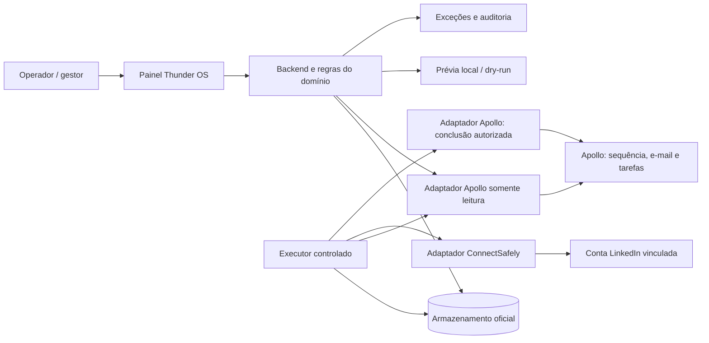

# Thunder OS — visão, especificação, arquitetura e plano de execução

**Documento de contexto para avaliação externa — 03/11/2026**  
**Responsável pelo produto:** Ygor Bueno / Thunder Mustard  
**Estado:** proposta consolidada; não é prova de funcionamento, aprovação de envio ou autorização de deploy.  
**Objetivo:** permitir que um especialista ou o Entire entenda o produto desejado, avalie o código existente e ajude a executar o plano sem reinventar o sistema.

## 1. Resumo executivo

O Thunder OS deve ser uma plataforma própria de go-to-market (GTM) e prospecção multicanal. A Thunder poderá usá-la em suas campanhas e, no futuro, oferecê-la ou configurá-la para outras empresas. Uma empresa deve conseguir trabalhar com várias contas de LinkedIn, várias caixas de e-mail e um CRM, preservando a identidade de cada conta e o histórico de cada lead.

A primeira jornada priorizada usa **Apollo + LinkedIn**: o Apollo continua criando e controlando a sequência e enviando seus e-mails. Quando a sequência gerar uma tarefa manual de LinkedIn, o Thunder OS deve identificá-la, verificar campanha, pessoa e conta responsável, preparar ou executar a ação via ConnectSafely conforme a autorização, registrar o resultado e atualizar a tarefa no Apollo quando for seguro. A campanha e suas regras são aprovadas uma vez; não é necessário aprovar individualmente cada ação dentro dessa autorização. O primeiro teste com envio real, porém, depende de autorização específica de Ygor.

Em fases posteriores, o Thunder OS deve permitir importar listas, criar e operar suas próprias cadências e conectar CRMs e provedores diferentes. Essa visão é o destino do produto; ela não deve ser confundida com funcionalidades já comprovadas.

## 2. Problema, usuários e resultado esperado

Hoje é possível selecionar leads, criar sequências e enviar e-mails no Apollo, mas falta uma ponte confiável para integrar os passos de LinkedIn à mesma cadência. O risco é perder tarefas, usar a conta errada, duplicar contatos ou continuar abordando alguém que já respondeu.

**Usuários:** administrador da empresa, gestor de campanha, operador comercial e, em momento posterior, membros de outras empresas com acesso isolado. A implantação inicial é para a Thunder; isolamento multiempresa completo precisa ser implementado e testado antes de receber clientes.

**Jornada desejada:**

1. Administrador conecta e identifica as contas necessárias, sem expor credenciais a quem usa a campanha.
2. Gestor associa uma sequência do Apollo a uma campanha Thunder OS e define a conta padrão de LinkedIn, conteúdo e regras.
3. Gestor revisa e aprova a versão da campanha e suas regras, inclusive as consequências da conclusão de uma tarefa sobre a sequência Apollo.
4. Apollo avança sua cadência e gera uma tarefa manual de LinkedIn para uma pessoa matriculada.
5. Thunder OS lê a tarefa, verifica todos os vínculos e apresenta lead, ação, conta, texto quando conhecido, fonte e bloqueios.
6. Quando o executor estiver autorizado e ativo, o sistema verifica novamente os pré-requisitos, reserva a ação e solicita a operação ao ConnectSafely.
7. Com resultado confirmado, grava evidência e conclui a tarefa Apollo somente quando as regras permitirem. Caso não haja confirmação, coloca o caso em exceção, sem repetir automaticamente uma ação incerta.
8. Operador acompanha resultados, respostas, cobertura e problemas no painel. Resposta em um canal deve interromper os demais quando a detecção e a pausa forem comprovadas.

**Indicadores:** número de tarefas elegíveis e bloqueadas por motivo; ações confirmadas, falhadas e incertas; tarefas Apollo concluídas e pendentes de reconciliação; respostas detectadas e pausas confirmadas; cobertura e data da leitura. A taxa e o tempo de processamento devem ser medidos por campanha e período. Metas comerciais numéricas dependem de uma linha de base real; não inventar percentuais.

## 3. Fonte de verdade e estado conhecido

| Elemento | Evidência disponível | Interpretação |
|---|---|---|
| Repositório | `github.com/ygorbuenobr/thunder-os`; checkout local em `main`, commit `7d5b3d1`, observado em 03/11/2026 | Código-fonte; não demonstra por si só versão publicada ou comportamento em produção. |
| Painel e leitura | O código principal contém uma rota de prévia Apollo/LinkedIn e componentes de leitura | Presença em código não demonstra que a jornada inteira funciona. |
| Execução simulada | Há especificação e executor com provedores simulados no repositório | Prova de exercícios locais, não de envio real ou atualização externa. |
| Branch `codex/apollo-linkedin-t3` | Foi encontrada no commit `3adf2d7`, com leitor e preparação adicionais | Trabalho separado; não presumir merge, deploy ou aprovação final. Uma revisão independente apontou problemas que requerem resolução. |
| Teste Apollo | Foi relatada a criação de sequência e tarefa de teste; a tarefa de convite para o próprio perfil deve continuar ativa e não deve ser executada nem concluída | Fixture útil para leitura; não é um convite possível e não prova envio. Confirmar origem e campos diretamente no Apollo antes de usá-la como evidência de contrato. |
| Produção | Não foi revalidada para este documento | Versão ativa, executor, sessões e dados externos precisam de leitura própria e datada. |

O checkout, uma branch, um PR, uma release, o processo ativo e uma jornada verificada são coisas diferentes. Nenhum deles prova automaticamente os demais. Registrar as evidências com data, origem, versão e limites.

## 4. Escopo por fase

### Fase 0 — reconciliar o trabalho existente

Identificar o diff da branch T3 contra a base correta e fechar as observações concretas da revisão independente: vinculação correta da credencial ao cliente, leitura do painel sem escrita nem capacidade de envio e eventuais regressões demonstradas. Rodar testes focados e revisão sobre o diff final. Não reconstruir a solução sem necessidade. Fonte, merge e deploy precisam de evidências distintas.

### Fase 1 — Apollo + LinkedIn: leitura e prévia

- Ler tarefas Apollo reais de uma campanha autorizada, em modo somente leitura.
- Ligar cada tarefa à empresa, organização Apollo, sequência, lead e conta LinkedIn da campanha.
- Mostrar ação, conta, lead, texto **se realmente fornecido**, estado e impedimento; ausência de texto deve ser visível, não preenchida por suposição.
- Montar a intenção de chamada ConnectSafely em dry-run local, sem disparar ação e sem concluir tarefa.
- Executor de ações desligado; leituras do painel não devem reservar, alterar banco, concluir tarefa nem enviar.
- Convites e mensagens são os tipos previstos; visitas ou interações só entram após contrato e testes próprios.

### Fase 2 — execução controlada e reconciliação

- Implementar a execução real protegida pelos critérios deste documento e pelo contrato efetivamente comprovado do provedor.
- Preparar um teste de mensagem do LinkedIn do Ygor para uma conexão escolhida por ele, com texto exato mostrado antes; não presumir qual é o texto nem que a tarefa já existe.
- Primeiro envio somente com a frase específica de autorização do Ygor. Confirmação de recebimento e atualização no Apollo devem ser verificadas separadamente.
- A tarefa de autoconvite não será executada, concluída ou pausada como parte desse teste.

### Fase 3 — controle multicanal

Consolidar e-mails, tarefas, respostas e resultados por campanha e lead. Detectar resposta e impedir os passos seguintes em todos os canais integrados; se a pausa no provedor for possível, exigir confirmação por leitura de volta. Se a cobertura for parcial, mostrá-la e impedir afirmações de completude.

### Fase 4 — plataforma própria

Importar listas, criar campanhas e sequências no Thunder OS, operar e-mail próprio por integrações apropriadas, registrar respostas e integrar CRMs por adaptadores. Definir quando o Thunder OS é o dono da cadência e quando apenas observa uma cadência externa. Não permitir dois motores independentes comandando a mesma etapa.

### Fase 5 — multiempresa e extensões

Disponibilizar o produto a outras empresas com autenticação, autorização, isolamento de dados e credenciais, operação e suporte compatíveis. Adicionar CRMs, provedores, automações e funções de IA conforme demanda e custo medidos. Não presumir suporte universal a qualquer CRM sem implementar e validar seu adaptador.

## 5. Requisitos e critérios de aceite

**P0: jornada Apollo + LinkedIn**

| ID | Requisito e critério verificável |
|---|---|
| R01 | A sequência e os e-mails Apollo continuam sob controle do Apollo; o OS não cria uma segunda cadência paralela para a mesma matrícula. |
| R02 | Ao ler tarefas, identificar fonte, empresa, organização, campanha/seqüência, tarefa, lead, tipo e situação; se um vínculo obrigatório não puder ser confirmado, bloquear a execução e explicar. |
| R03 | Uma empresa pode cadastrar mais de uma conta de LinkedIn e mais de uma conta de e-mail. Disponibilidade e conexão real devem ser demonstradas por provedor, não inferidas do cadastro. |
| R04 | Quando a tarefa não especificar claramente uma conta LinkedIn, usar a conta padrão vinculada à campanha; se não houver conta válida, bloquear. Nunca trocar silenciosamente para outra conta. |
| R05 | Uma aprovação associa campanha, versão, ações, textos e regras; alterações relevantes invalidam ou exigem nova aprovação conforme política explícita. A conclusão no Apollo pode avançar a sequência e precisa estar abrangida. |
| R06 | A tela mostra lead, conta, ação, texto conhecido, situação e motivo de bloqueio. Dados ausentes ou não confirmados aparecem como tais. |
| R07 | A prévia e os endpoints de consulta são somente leitura: não enviar, não concluir, não criar reserva nem causar gravações indiretas. |
| R08 | Existe um armazenamento oficial durável por instalação. A identidade de ação é única por empresa + ID da tarefa Apollo + tipo de ação; reservar de forma atômica e durável antes de executar. Dois armazenamentos independentes não são configuração suportada. |
| R09 | Para cada conta LinkedIn, permitir no máximo um executor ativo por meio de lock entre processos. Sem armazenamento oficial ou sem lock válido, o executor não inicia ou não atua e apresenta erro visível. |
| R10 | Imediatamente antes da ação, reler no Apollo a tarefa específica; se estiver fechada, indisponível ou inconsistente, não executar. Revalidar conta, autorização, resposta e demais pré-condições. |
| R11 | Resposta identificada antes da execução bloqueia o próximo contato. Resposta durante envio deve impedir avanço e conclusão indevida; como a ação pode já ter ocorrido, registrar resultado e tratar reconciliação sem alegar cancelamento retroativo. |
| R12 | Se o provedor confirmar a ação mas o Apollo não confirmar a conclusão, reconciliar somente o Apollo; não repetir o LinkedIn. Se o resultado do LinkedIn for desconhecido, interromper retry automático e encaminhar à caixa de exceções. |
| R13 | Nenhum estado de fila, requisição aceita, dry-run ou HTTP de prévia é tratado como recibo de ação ou prova de entrega. Guardar resultado e fonte disponíveis com horário. |
| R14 | Credenciais são associadas ao contexto certo e guardadas fora do código; leitura do painel usa capacidade somente de leitura, sem cliente que possa enviar. Segredos não aparecem em logs, repositório ou painel. |
| R15 | Tarefa de teste de autoconvite permanece intacta; primeiro envio real exige autorização específica. Ambiente simulado e real devem ser distinguíveis. |

**P1:** cobertura de campanha Apollo com métricas de enviados, pendentes, respostas e reuniões; exibir coorte observada separada de histórico preservado, origem, data e cobertura. A ausência de uma pessoa em leitura parcial não prova remoção. Detecção de resposta e pausa entre canais dependem de cobertura e comprovação de cada provedor.

**P2:** construtor de campanhas sem código, listas próprias, e-mail próprio, CRM adicional, multiempresa completo, funções de IA e Hermes no painel. As prioridades detalhadas podem mudar com evidência de uso; não são promessa de implementação presente.

## 6. Arquitetura proposta

**Direção:** evoluir o sistema existente como monólito modular com painel, domínio, adaptadores e executor separados por contratos internos. Aproveitar o armazenamento e as estruturas de fila, reserva e lease existentes quando atenderem aos invariantes; introduzir tabela, fila, processo ou serviço novo somente quando houver lacuna demonstrada. Não transformar cada módulo em microserviço.

**Fluxo seguro:** leitura → validação de identidade e regras → prévia → reserva durável única e lock da conta → nova leitura Apollo e verificação de respostas → ação autorizada → registro de resultado → conclusão Apollo autorizada → leitura de volta/reconciliação. A leitura final reduz a janela de corrida, mas não cria transação atômica entre fornecedores. Não prometer exatamente uma vez no sistema externo; tratar incerteza explicitamente.

### 6.1 Componentes

- **Painel:** operação de campanhas, contas, tarefas, aprovação, exceções, cobertura e histórico; sem acesso direto a segredos.
- **Backend:** autorização, vínculo entre entidades, normalização das tarefas, validação, consultas, regras de aprovação e API do painel.
- **Adaptador Apollo:** consulta de sequência/tarefa/lead e, separadamente, conclusão autorizada. Verificar campos reais e cobertura da API; detalhes de proprietário, prazo e conteúdo não devem ser inventados.
- **Adaptador ConnectSafely:** REST é a direção definida para execução; autenticação, vínculo com conta, capacidades, resposta e prova de resultado exigem validação. MCP pode apoiar investigação, sem ser dependência obrigatória do executor.
- **Executor:** recebe apenas ações elegíveis e aprovadas, impõe reserva, lock e checagens, registra tentativas e lida com falhas de fornecedor.
- **Armazenamento oficial:** autoridade dos vínculos, reservas, estado operacional e auditoria da instalação; indisponibilidade bloqueia execução.
- **Observabilidade:** logs estruturados sem segredos, alarmes e painel de exceções; retenção e acesso devem ser definidos conforme necessidade operacional.
- **Integrações futuras:** adaptadores para e-mail, CRM e outras fontes preservam contratos do domínio; cada integração declara suas capacidades e limites.

### 6.2 Estados e transições sugeridos

`observada → elegível → aprovada → reservada → em_envio → confirmada → conclusão_apollo_pendente → concluída`.

Desvios explícitos: `bloqueada` (motivo corrigível), `cancelada/fechada_na_origem`, `falha_confirmada` e `resultado_incerto`. Um estado não deve avançar baseado apenas em timeout ou mensagem otimista. Em reinício, recuperar reservas e leases sem repetir operação possivelmente enviada. Estados e nomenclatura são proposta: adaptar ao código real preservando os invariantes.

### 6.3 Contratos internos propostos

- `read_task(company, task_id)`: leitura Apollo da tarefa e dos campos comprovados, com origem e instante; erro ou ausência não vira tarefa aberta.
- `resolve_binding(company, campaign, task)`: retorna vínculo validado entre organização Apollo, sequência, lead, credencial e conta LinkedIn; ambiguidade bloqueia.
- `prepare_action(task, binding, approved_version)`: produz uma intenção local contendo tipo, destinatário, conta, conteúdo disponível e bloqueios; não acessa capacidade de envio nem grava estado.
- `reserve(action_key)`: operação atômica no armazenamento oficial; uma única reserva vencedora, resistente a processos concorrentes e reinício.
- `execute(reservation, account_lock)`: apenas executor habilitado; revalida pré-condições e consulta fornecedor. Retorna `confirmed`, `failed` ou `unknown` com evidência disponível.
- `complete_task(task_id, execution_receipt)`: só após critérios satisfeitos e dentro da autorização da campanha; falha ou dúvida gera reconciliação Apollo.

Esses nomes são interfaces de desenho, não afirmação de rotas ou classes existentes. Contratos reais de fornecedores precisam ser validados na documentação e com respostas observadas, sem expor dados sensíveis.

## 7. Linguagens, frontend, backend e banco de dados

| Camada | Hoje, segundo o repositório observado | Direção recomendada |
|---|---|---|
| Backend | **Python 3**, incluindo servidor HTTP próprio e módulos de domínio | Manter Python e evoluir por módulos; adotar framework somente se um problema concreto justificar migração. |
| Frontend | **HTML, CSS e JavaScript** no painel existente | Melhorar a jornada existente. React/TypeScript são opções futuras, não dependências exigidas nem stack atual comprovada. |
| Banco principal | **SQLite**, com repositório, transações e estruturas de estado/execução no código | Um armazenamento oficial por instalação; testar unicidade e lock entre processos. Avaliar PostgreSQL para escala/multiempresa quando necessidades e migração forem demonstradas. |
| Ledger de contatos | Integração separada com **PostgreSQL** via `toques.py`, dependência externa fixada por hash | Preservar contrato e ownership; não copiar, substituir ou tratar como banco principal sem investigação. |
| Testes e ferramentas | `unittest` Python; Node/JavaScript em testes e scripts auxiliares; ferramentas de shell | Testes isolados e focados; Node não é backend obrigatório. |
| Operação | Releases e serviços separados do checkout; scripts e contratos de empacotamento | Deploy reversível e verificável, com dados e credenciais fora do repositório. |
| IA e agentes | Há sistemas adjacentes; integração completa com esta jornada não está comprovada | Hermes e IA são posteriores; **Mastra, novo backend Node e reescrita não são prioridade atual**. Só avaliar mediante necessidade e custo demonstrados. |

Não escolher tecnologia por moda. Custo deve considerar desenvolvimento, hospedagem, APIs, limites de provedor, manutenção, observabilidade e tempo humano. Medir consumo real antes de estimar valores.

## 8. Modelo de dados conceitual

Os nomes abaixo descrevem responsabilidades; não afirmam que as tabelas já existem ou que uma migração foi aprovada.

| Entidade | Campos e responsabilidades principais |
|---|---|
| Empresa / workspace | Identificador, nome, estado e configurações; fronteira de isolamento. |
| Usuário e permissão | Identidade e papel por empresa; operações de leitura, aprovação, configuração e execução autorizadas no servidor. |
| Conexão de provedor | Empresa, tipo, identidade da organização externa, estado e referência segura à credencial; segredo fora da tabela de negócio e do Git. |
| Conta de canal | Empresa, provedor, identificador externo, tipo LinkedIn/e-mail, status de conexão e capacidade. Mais de uma por empresa. |
| Campanha e versão | Empresa, objetivo, origem, sequência externa quando existir, conta padrão por canal, conteúdo, regras e versão aprovada. |
| Lead e matrícula | Identidade na empresa, identificadores externos, canais conhecidos e vínculo com campanha; tratar colisões e duplicidade. |
| Tarefa externa | Empresa, Apollo task ID, sequência, lead, tipo, situação, campos recebidos e data da observação. |
| Ação / reserva | Chave única empresa + tarefa Apollo + tipo, versão aprovada, conta, estado, lock/lease e timestamps. |
| Tentativa e evidência | Provedor, tentativa, resultado confirmado/falha/incerto, identificador e recibo disponíveis; sem segredos nem dados desnecessários. |
| Resposta / interrupção | Lead, canal, fonte, instante, cobertura, bloqueio e confirmação de pausa por provedor. |
| Exceção e auditoria | Motivo, responsável, resolução, histórico de transições e rastreio de alterações. |

Consultas e restrições devem incluir a empresa; IDs externos não devem ser considerados globalmente exclusivos sem prova. Em caso de associação ambígua ou colisão, bloquear e solicitar resolução. Migração de SQLite para PostgreSQL exige desenho específico, backup, validação de integridade, corte reversível e verificação; não está automaticamente autorizada por este documento.

## 9. Interface e operação

1. **Visão geral:** campanhas, ações confirmadas, pendências, respostas, exceções e integridade da leitura; distinguir cobertura parcial e dados antigos.
2. **Contas e conexões:** múltiplos LinkedIn/e-mails, proprietário, vínculo à empresa, estado, uso por campanha e erro de conexão; nunca revelar credenciais.
3. **Campanhas:** origem Apollo ou nativa, versão, regras, conta padrão e status da aprovação; mostrar dependências e efeito de concluir tarefa.
4. **Tarefas LinkedIn:** lead, origem, ação, conta resolvida, texto conhecido, elegibilidade, prévia e bloqueios. Autoconvite deve ser bloqueado.
5. **Caixa de exceções:** reserva ocupada, conta inválida, tarefa fechada, resposta detectada, falha, resultado incerto e reconciliação Apollo; cada caso com contexto e próxima ação segura.
6. **Histórico:** quem aprovou, qual versão, eventos, resultado e evidência da fonte; fila e envio confirmado separados.
7. **Nova jornada futura:** criar campanha e importar lista sem código, com revisão de dados e configuração por canal; não tratar como funcionalidade pronta.

A apresentação deve ser utilizável por gestor comercial: explicações simples e ações claras, preservando detalhes técnicos como informações de diagnóstico quando úteis.

## 10. Integrações e fronteiras

**Apollo:** sequência, matrícula e envio de e-mail permanecem nele na primeira fase. Ler tarefa real, lead e campanha com vínculo validado; distinguir responsável pela tarefa, identidade do usuário API e proprietário da conta. Confirmar os campos reais em cada endpoint e a paginação/cobertura. Atualizar tarefa somente no fluxo permitido, ciente de que isso pode destravar a sequência.

**ConnectSafely:** mapear a credencial à identidade e à conta certas; suportar ações efetivamente disponíveis e diferenciar intenção, aceitação, falha e confirmação. A prévia é gerada localmente e não deve fazer chamada de envio. A disponibilidade de sessão não pode ser presumida.

**CRM:** o objetivo é adaptar o Thunder OS a CRMs diferentes. HubSpot pode ser o primeiro caso, mas mapeamento de identidade, empresa, contato, permissões e política de escrita exigem desenho e verificação próprios. Não criar/alterar registros como efeito indireto de uma leitura.

**E-mail:** inicialmente enviado pelo Apollo; caixas e regras pertencem à configuração real da sequência. Em fase nativa, escolher provedor, autenticação, limites, resposta, rastreabilidade, reputação e tratamento de falhas antes de implementar envio.

**LinkedIn:** manter conta remetente explícita e bloqueios por conta. Uma pessoa não pode receber convite do próprio perfil; teste de mensagem deve usar conexão válida e autorização específica. Respeitar políticas e limites aplicáveis do fornecedor, sem inventar números.

## 11. Segurança, integridade e limites operacionais

- Autenticação e autorização verificadas no backend; isolamento por empresa e credencial em cada leitura e escrita. Produto para terceiros só após testes de isolamento.
- Aprovações versionadas, executor desligável, limites por conta e visibilidade de sessão. Falha de controle ou armazenamento bloqueia ação.
- Proteção contra duplicidade pela reserva transacional no único armazenamento oficial e lock por conta; testar dois processos, reinício e reentrega.
- Não executar tarefa fechada, ambígua, já reservada, sem conta, sem autorização válida ou com resposta conhecida.
- Resultado desconhecido exige intervenção/reconciliação, não retry cego. Uma resposta que chega durante uma chamada externa não pode desfazer uma ação já aceita.
- Logs sem tokens, conteúdo sensível desnecessário ou dados de clientes no repositório. Definir retenção, acesso e auditoria por instalação.
- Envio real a pessoas e ativação de automação que envia exigem autorização específica vigente. O conteúdo deste documento não é tal autorização.

## 12. Plano de trabalho e dependências

| Ordem | Entrega | Critério de saída |
|---|---|---|
| 0 | Reconciliar main, branch e revisão | Diff identificado, problemas concretos corrigidos ou registrados; teste focado e revisão independente do resultado. |
| 1 | Contrato da tarefa Apollo | Campos, identidade, paginação e status comprovados em leitura; dados faltantes documentados. |
| 2 | Vínculo de conta e prévia | Conta, lead, ação e texto conhecido visíveis; leitura sem escrita; tarefa de autoconvite bloqueada. |
| 3 | Executor protegido em ambiente simulado | Testes de concorrência, reserva, lock, respostas e falhas verdes; nenhuma chamada real de envio. |
| 4 | Adaptador real e canário preparado | Chamada e destinatário validados; texto exato apresentado; executor permanece desligado até autorização específica. |
| 5 | Canário autorizado | Uma ação real permitida, recibo e estado Apollo verificados; tratar incertezas sem repetir. |
| 6 | Cobertura Apollo e parada entre canais | Métricas com fontes/cobertura; teste de resposta e pausa com confirmação do fornecedor. |
| 7 | Campanha própria e CRM | Especificações próprias, provedor escolhido e integração testada por capacidade. |
| 8 | Outras empresas | Isolamento, administração, operação, dados e segurança comprovados antes de onboarding. |

Não há prazos de entrega ou orçamento aprovados para cada etapa. Dividir trabalho em mudanças pequenas, com evidência e rollback, sem adicionar filas ou infraestrutura por antecipação.

## 13. Matriz mínima de validação

| Cenário | Resultado esperado |
|---|---|
| Mesma tarefa lida duas vezes no mesmo armazenamento | Apenas uma identidade de ação; sem duplicação ou envio. |
| Dois processos disputam a mesma reserva | Exatamente um vencedor local; perdedor não chama fornecedor. |
| Dois executores da mesma conta | Apenas um mantém lock; segundo não executa. |
| Armazenamento oficial indisponível | Executor falha fechado com erro visível. |
| Tarefa fechada no Apollo antes da ação | Nova leitura identifica fechamento; nenhum envio. |
| Conta ausente, ambígua ou de outra empresa | Bloqueio explícito; nenhuma troca silenciosa. |
| Resposta antes / durante execução | Bloquear quando possível; se houve envio em curso, impedir conclusão indevida e registrar/reconciliar o resultado. |
| Provedor confirma LinkedIn e Apollo falha | Não repetir LinkedIn; reconciliar conclusão Apollo. |
| Timeout ou resultado incerto no LinkedIn | Exceção; nenhum retry automático de envio. |
| Prévia, refresh ou consulta do painel | Sem escrita externa, reserva ou efeito de envio; exibir dados não conhecidos. |
| Reinício em cada etapa | Recuperação segura, preservando evidências e sem envio duplicado. |
| Duas empresas e credenciais | Acesso cruzado negado; conta e dados nunca confundidos. |
| Cobertura parcial / dados históricos | Mostrar período e fonte; não inferir que histórico é coorte atual. |

Rodar testes focados no código alterado, testes de integração isolados com fornecedores simulados e, quando autorizado, validação com provedores reais. O canário só prova o cenário específico executado. Avaliar se o teste falha quando o comportamento protegido falha; não enfraquecer testes para obter verde.

## 14. Deploy, operação e recuperação

O repositório de código é `ygorbuenobr/thunder-os`; conhecimento de projeto e dados operacionais têm fronteiras distintas. O `toques.py` externo deve manter o hash definido no contrato do bundle. Não copiar `.env`, bancos, tokens, respostas de clientes ou estado do navegador para o repositório.

Antes de publicar: identificar host, checkout limpo, commit exato, dependências e release ativa; preparar release imutável e rollback. Após publicação: verificar processo realmente carregado, saúde, configuração, executor desligado quando requerido, leitura do painel e logs. Se quebrar, restaurar a release anterior e verificar novamente. Merge não prova deploy; deploy não prova sessão, envio ou resultado externo.

## 15. Decisões já tomadas e perguntas abertas

**Decisões:** Apollo é dono da cadência inicial; ConnectSafely REST é a direção do canal LinkedIn; conta padrão pertence à campanha; campanha/regras são aprovadas uma vez; múltiplas contas por empresa; uma base oficial por instalação; chave única por empresa/tarefa/tipo; lock por conta; releitura Apollo antes da ação; resultado incerto não é repetido automaticamente; primeiro envio exige frase específica; multiempresa completo vem depois.

**A validar por engenharia/provedor antes da execução:**

- Qual estrutura real identifica sequência, responsável, tipo e texto na tarefa gerada pelo Apollo, e qual é a cobertura da leitura?
- Como ConnectSafely associa credencial e conta, quais respostas comprovam ação e como verificar estado após timeout?
- Como detectar resposta em cada canal, em que intervalo e com qual cobertura? Que API efetivamente pausa a sequência e permite leitura de volta?
- Quais mudanças de campanha invalidam aprovação e qual política exata de limites será adotada por conta?
- Qual texto exato será usado no teste para a conexão escolhida, qual tarefa correspondente será criada e qual confirmação externa será suficiente?
- Quando o volume e a necessidade de vários clientes justificam PostgreSQL, qual migração reversível e qual modelo de autorização serão adotados?
- Quais custos reais de APIs, hospedagem e operação aparecem com a primeira jornada?

## 16. Instruções para avaliação pelo Entire ou outro especialista

Leia este documento como contexto e confronte-o com o repositório e os contratos oficiais atuais. Faça uma revisão técnica e de produto que:

1. Separe o que está implementado no `main`, o que está somente em branch, o que está ativo em produção e o que é proposta. Solicite evidência quando não tiver acesso; não infira runtime do código.
2. Identifique lacunas que impeçam a primeira jornada e sugira o menor conjunto de mudanças para fechá-las, com arquivos, testes e ordem.
3. Examine isolamento, vínculo de credencial, idempotência, lock, resultado incerto, resposta durante envio, conclusão Apollo e efeito de avançar a cadência.
4. Avalie se a stack existente é adequada, com custos e riscos; justifique qualquer tecnologia nova e apresente alternativa que aproveite o código atual.
5. Proponha contratos, plano por etapas, testes negativos, critérios de aceite e rollback. Marque decisões pendentes e hipóteses; não invente endpoints, dados ou recursos dos fornecedores.
6. Preserve a fixture de teste e não envie mensagens, execute convites, conclua tarefas ou ative automação. Não solicite nem registre segredos.

**Resposta esperada:** diagnóstico objetivo, divergências por gravidade, arquitetura recomendada, alterações mínimas por fase, riscos, testes e decisões que realmente precisem do Ygor.

## 17. Fontes internas para conferência

- Direção de produto: `thunder-gtm/projetos/thunder-os/direcao-unica.md`.
- Desenho anterior: `thunder-gtm/projetos/thunder-os/cadencia-multicanal/.design/thunder-os-apollo-linkedin-2026-11-03.md`.
- Código: `thunder-os/_ferramentas/painel_servidor.py`, `painel_modelo.html`, módulos `thunder_os/` e testes correspondentes.
- Especificação da fatia simulada: `thunder-os/.specs/features/apollo-linkedin/`.
- Contrato da dependência externa: `thunder-os/runtime/dependencies.json`.
- Mapa de sistemas e fronteiras: `thunder-gtm/SISTEMA.md`.

Essas referências são caminhos locais do ambiente do Ygor. Quem receber somente este documento não terá acesso automático ao código ou aos arquivos mencionados; a avaliação de implementação precisará do repositório ou de um recorte sanitizado.
